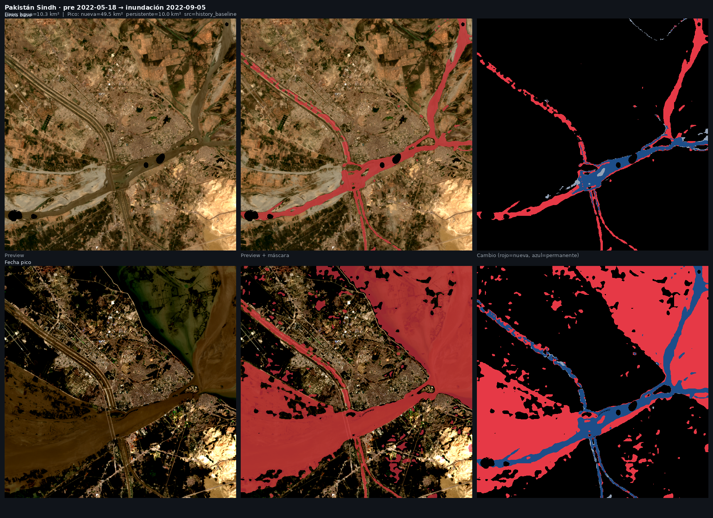
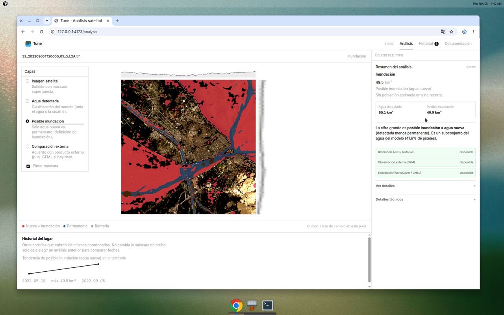
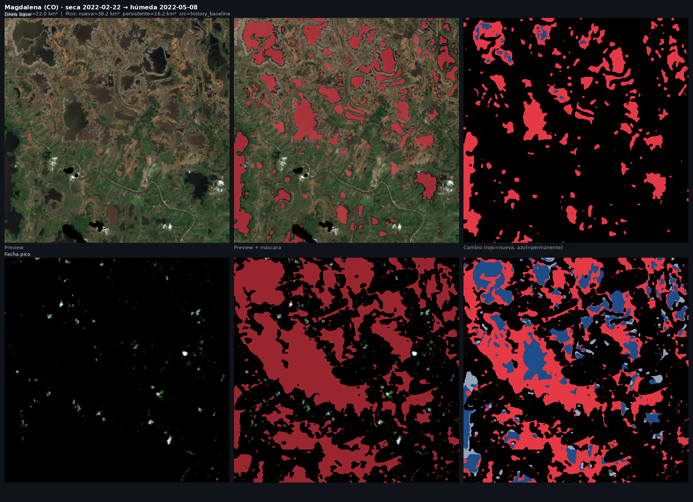
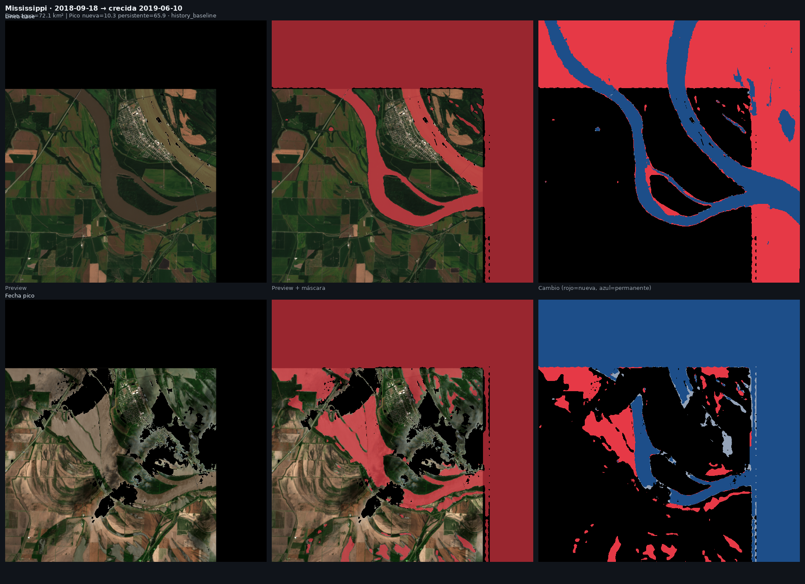

<div align="center">
  
  
</div>

##

Aplicación de análisis satelital de inundación con los modelos Prithvi-EO 2.0 publicados por IBM-NASA. Se sube un GeoTIFF o se busca una escena Sentinel-2 por coordenada. El modelo detecta agua, y Tune calcula **inundación como agua nueva** frente a una referencia (JRC o historial del mismo territorio). Cuando hay dato, compara con Copernicus GFM y resume cobertura y población sobre el agua nueva.

La misma infraestructura admite, de forma secundaria, cicatriz de incendio con el checkpoint Burn Scars. El núcleo del proyecto y de la demostración es inundación.

## Resultados verificados (inundación ≠ solo agua)

Se analizó primero una **línea base** y después el **pico** en el mismo punto (`side_km=12`). En el mapa de cambio: **rojo = agua nueva**, **azul = permanente**.

### Pakistán Sindh · mayo → septiembre 2022

Crecida documentada. Pico: ~49 km² nuevas + ~10 km² permanentes (`history_baseline`).





### Bajo Magdalena (Colombia) · febrero → mayo 2022

Humedal: JRC solo no basta; la fecha seca como baseline sí. Pico: ~38 km² nuevas + ~16 km² permanentes.



### Mississippi (EE. UU.) · 2018 → crecida 2019

Tercer sitio verificado: nueva ~10 km² sobre un cauce ya permanente (~66 km²).



Recetas paso a paso (IDs STAC, orden, qué mirar en la UI): en la app **How to use**, o [docs/validation/casos-demostracion.md](./docs/validation/casos-demostracion.md). Evidencia en [`docs/assets/proof/`](./docs/assets/proof/).

## Cómo levantar la app

```bash
cp .env.example .env
make app-up      # levanta API y web
make app-logs    # sigue los logs (primera vez descarga pesos)
make app-down    # apaga todo
```

- Web: http://localhost:8080 — menú **How to use** para demos verificadas
- API: http://localhost:8000/docs

### Docker Compose

Desde la raíz del repo, con `.env` ya creado:

```bash
docker compose up -d --build    # construye tune-eo-api y tune-web, y los levanta
docker compose logs -f eo-api   # logs de la API
docker compose down             # apaga y borra contenedores
```

`down` conserva el volumen `hf-cache` (pesos de Hugging Face, ~1,2 GB la primera vez) y la carpeta `artifacts/`.

En una VM pública: `API_BIND=127.0.0.1` en `.env` para no exponer `:8000`.

## Documentación

| Documento | Qué es |
|---|---|
| [docs/GuiaDeUso.md](./docs/GuiaDeUso.md) | Manual de uso |
| [docs/validation/casos-demostracion.md](./docs/validation/casos-demostracion.md) | Pares STAC donde inundación ≠ solo agua |
| [docs/Instalación.md](./docs/Instalación.md) | Cómo instalar y levantar |
| [docs/Desarrollo.md](./docs/Desarrollo.md) | Cómo tocar el código |
| [docs/decisions/](./docs/decisions/) | ADRs |
| [lab/README.md](./lab/README.md) | Fine-tuning (secundario) |

## Estudiantes

| Nombre | GitHub |
|---|---|
| Carlos Andrés Galvis Pájaro | [@Charlsz](https://github.com/Charlsz) |
| Zenen Contreras Royero | [@zenencontreras](https://github.com/zenencontreras) |
