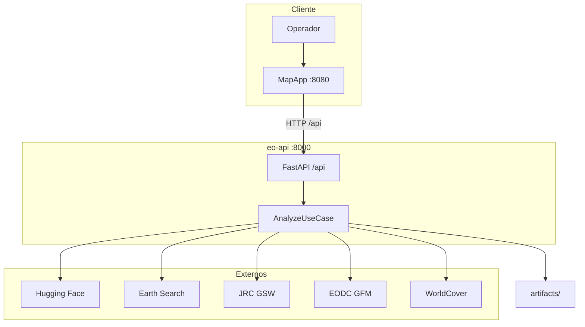
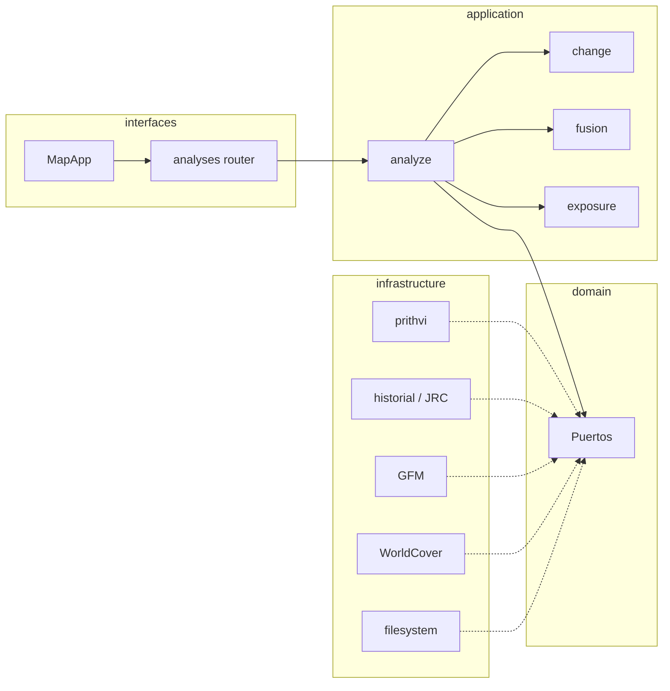
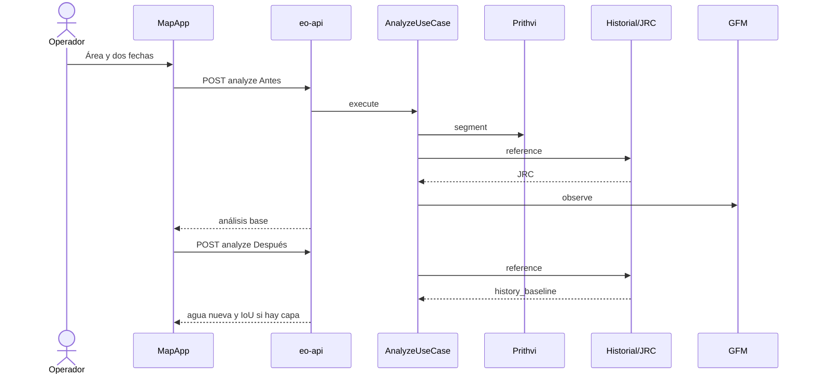
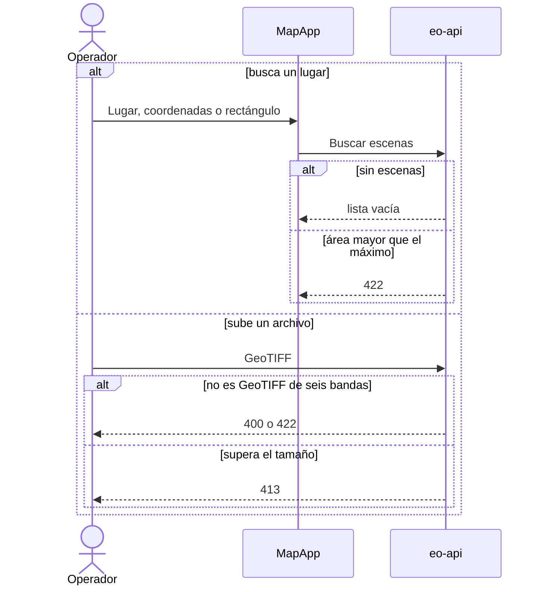
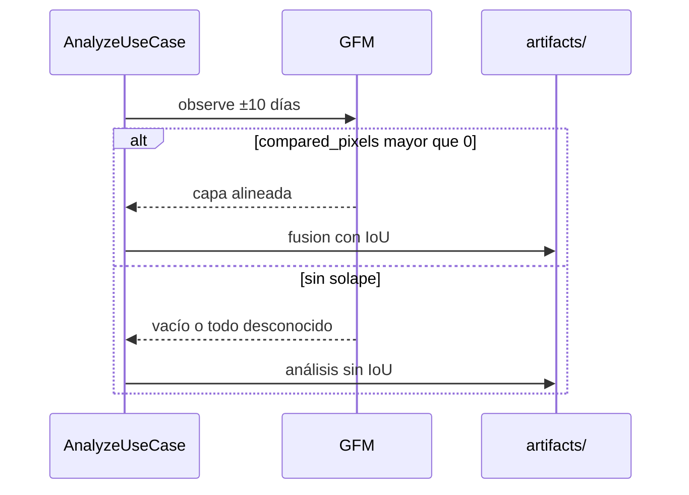
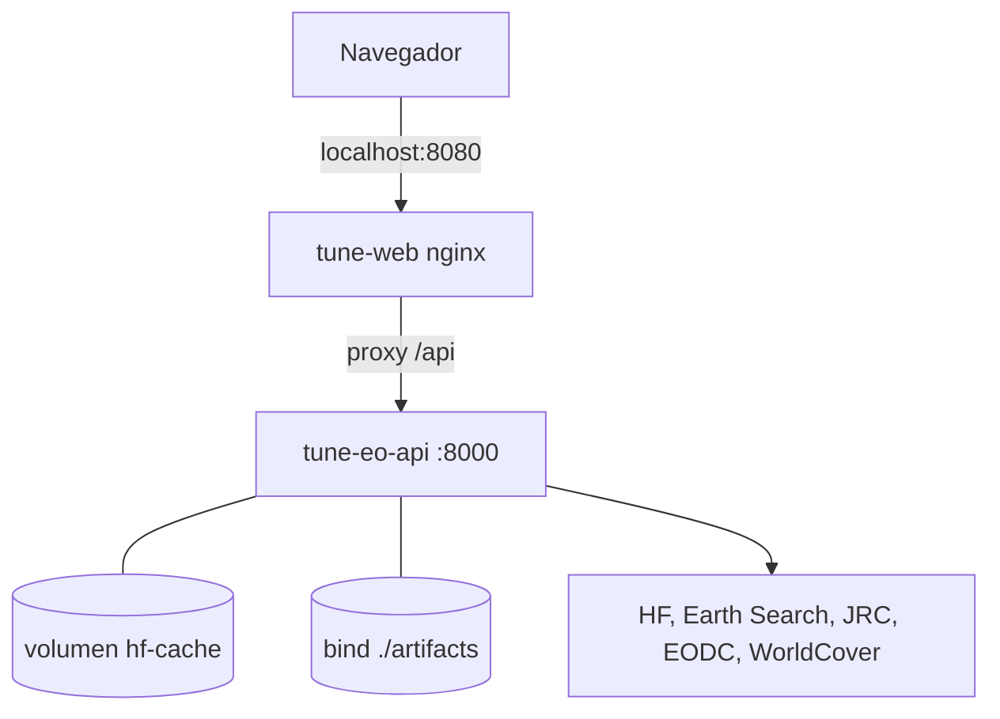
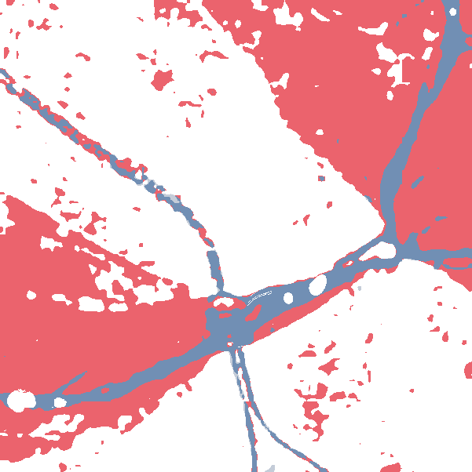
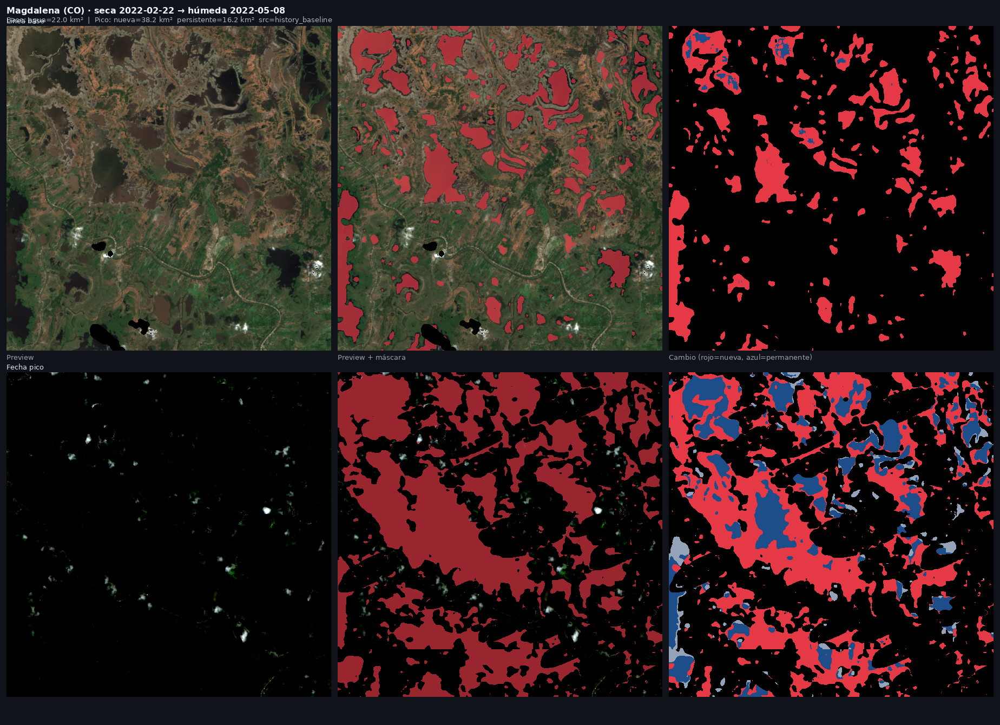

# Tune: análisis satelital de inundación como cambio hídrico con Prithvi-EO 2.0

Autores: Carlos Andrés Galvis Pájaro y Zenen Contreras Royero.  
Informe final, noviembre de 2026. Repositorio: https://github.com/Charlsz/Tune.

## Resumen / Abstract

En este proyecto construimos Tune, una aplicación que distingue el agua permanente de la inundación. El operador busca un nombre, pega coordenadas, marca un rectángulo o sube un GeoTIFF de seis bandas. Sobre esa escena, o sobre las escenas Sentinel-2 de dos fechas, el checkpoint `ibm-nasa-geospatial/Prithvi-EO-2.0-300M-TL-Sen1Floods11` clasifica agua. La inundación es el agua nueva frente a la escena anterior del mismo lugar o, si no hay historia, frente a Global Surface Water del Joint Research Centre (JRC). Cuando Copernicus Global Flood Monitoring (GFM) cubre esa zona y fecha, el proyecto calcula el acuerdo (Intersection over Union, IoU).

La aplicación es cliente-servidor (FastAPI y MapApp en React/Leaflet) y se despliega con Docker Compose. En Sindh (Pakistán), entre mayo y septiembre de 2022, el agua pasó de 10,34 km² a 60,22 km² y la inundación fue 49,56 km². En el Bajo Magdalena la inundación fue 38,25 km² y en el Mississippi, 10,26 km² sobre un río que ya ocupaba 65,85 km². El acuerdo con GFM fue 0,20 en el pico de Sindh y 0,32 en el pico del Mississippi.

---

## 1. Introducción

Los foundation models geoespaciales desplazaron parte del trabajo práctico desde el preentrenamiento hacia el uso de pesos ya especializados. Prithvi-EO 2.0 y el checkpoint Sen1Floods11 de IBM–National Aeronautics and Space Administration (NASA) detectan agua sobre escenas ópticas. El vacío que este proyecto aborda es una aplicación que, a partir de un lugar y dos fechas o de un GeoTIFF ya preparado, respete el procedimiento oficial de inferencia y deje un resultado interpretado y recuperable, sin presentar el cauce permanente como inundación.

El planteamiento inicial era un laboratorio de Machine Learning Operations (MLOps) de fine-tuning. La orientación del curso y la viabilidad técnica nos llevaron a fijar tarea, dataset de procedencia, modelo y criterios verificables en una aplicación de análisis. Tune materializa esa orientación: inundación como cambio hídrico, entrada por lugar, coordenada, rectángulo o GeoTIFF, y acuerdo con GFM (Global Flood Monitoring) cuando hay dato.

## 2. Marco conceptual

### 2.1 Raster, bandas Prithvi y segmentación

Una imagen operativa es un raster georreferenciado. Prithvi-EO 2.0 espera seis bandas (azul, verde, rojo, Near-Infrared (NIR) estrecho, Short-Wave Infrared 1 (SWIR1), Short-Wave Infrared 2 (SWIR2)). En este proyecto esas bandas llegan de dos maneras: la escena Sentinel-2 del lugar elegido, o un GeoTIFF que el operador sube ya con esas seis bandas. Un archivo que no es GeoTIFF, o que no trae las bandas, no se analiza. La segmentación asigna clase por píxel; el área en km² se obtiene del tamaño de píxel por el conteo positivo, excluyendo nodata.

### 2.2 Foundation model y checkpoint

Tune consume, sin reentrenar, el checkpoint Sen1Floods11. La inferencia oficial recorta ventanas 512×512 y recompone la máscara (TerraTorch). El identificador del modelo viaja en cada análisis. El directorio `lab/` conserva material de fine-tuning fuera del núcleo evaluado.

### 2.3 Cambio hídrico, fusión y exposición

**Agua detectada** es la máscara del modelo. **Inundación** es el agua que no pertenece a la referencia (la escena anterior del mismo lugar, o el agua permanente del JRC (Joint Research Centre) cuando occurrence es al menos 75 %). **Acuerdo** alinea GFM (ensemble flood extent, SpatioTemporal Asset Catalog (STAC) del Earth Observation Data Centre (EODC), ventana de ±10 días) a la grilla del análisis y calcula el IoU (Intersection over Union). La cobertura del suelo (WorldCover) describe sobre qué cae el agua nueva.

## 3. Planteamiento del problema

### 3.1 Descripción del problema

Disponer del modelo y del dataset no basta si el resultado no distingue cauce de desborde ni puede consultarse después. Scripts aislados producen máscaras sin contrato; laboratorios de entrenamiento no entregan análisis si la GPU (Graphics Processing Unit) no cierra. Quienes necesitan una lectura defendible de inundación carecen de un sistema integrado, portable y acotado.

### 3.2 Restricciones y supuestos de diseño

Prototipo académico (sin multi-tenancy, Open Authorization (OAuth) ni Service Level Agreement (SLA)). Un análisis a la vez en Central Processing Unit (CPU) tras cachear pesos. Datasets y productos públicos. Sin preentrenamiento de foundation models. Sin pronóstico hidrológico ni profundidad del agua. GFM y WorldCover pueden fallar sin tumbar el análisis.

### 3.3 Alcance

**Incluye:** búsqueda por lugar, coordenadas o rectángulo; subida de un GeoTIFF de seis bandas; escenas Sentinel-2; inferencia Prithvi de agua; cambio frente al historial o al JRC; acuerdo con GFM; cobertura del suelo; Application Programming Interface (API); MapApp (área, fechas, escenas, Antes/Después/Cambio/Acuerdo); Docker; validación en tres territorios. Cicatriz de incendio como tarea auxiliar.

**Excluye:** reentrenamiento como entregable, autenticación, colas, PostGIS (extensión espacial de PostgreSQL), anclar el producto a un solo territorio, User Interface (UI) legacy con router (conservada en código no montado).

## 4. Objetivos

**General.** Ejecutar el checkpoint Sen1Floods11 sobre una escena Sentinel-2 localizada por el operador o sobre un GeoTIFF de seis bandas; guardar el análisis con el identificador del modelo; calcular el agua nueva frente al historial del lugar o al JRC; y registrar el acuerdo con GFM cuando exista capa.

**Específicos.** (1) Buscar por nombre, coordenadas o rectángulo, y aceptar también un GeoTIFF válido. (2) Integrar Prithvi con TerraTorch sin reentrenar. (3) Persistir agua detectada, agua nueva, agua permanente y acuerdo. (4) Mostrar Antes, Después, Cambio y Acuerdo en MapApp. (5) Medir la inundación, en km², en Sindh, el Bajo Magdalena y el Mississippi.

## 5. Estado del arte / soluciones relacionadas

Prithvi-EO 2.0 (Szwarcman et al., 2024) y Sen1Floods11 (Bonafilia et al., 2020) fijan el detector. Global Surface Water (GSW) del JRC (Pekel et al., 2016) aporta permanente. Copernicus GFM, Observational Products for End-Users from Remote Sensing Analysis (OPERA) Dynamic Surface Water Extent (DSWx), Flood Hub y prácticas de United Nations Platform for Space-based Information for Disaster Management and Emergency Response (UN-SPIDER) cubren fragmentos operativos. Tune no los sustituye. Aplica el checkpoint como agua detectada, separa la inundación con la referencia permanente y la confronta con el radar cuando hay dato, en cualquier coordenada que el operador marque.

## 6. Solución propuesta

Tune es la aplicación de análisis satelital de este proyecto. Hay dos entradas. En el mapa, el operador busca un lugar, pega coordenadas o dibuja el rectángulo, elige dos fechas y las escenas Sentinel-2. Si ya tiene la imagen preparada, sube un GeoTIFF de seis bandas y el mismo análisis corre sobre ese archivo. MapApp muestra la máscara, el cambio (rojo = inundación, azul = agua que ya estaba) y el acuerdo con GFM cuando hay capa. El valor frente a un script suelto es esa lectura, guardada y repetible.

## 7. Metodología de desarrollo

Prototipado iterativo: cada ciclo dejó contrato, puerto, prueba o Architecture Decision Record (ADR). Iteraciones visibles en git: laboratorio hexagonal → app de inferencia (ADR 005) → cambio hídrico (ADR 010) → catálogo, fusión (ADR 014), exposición (ADR 015) → MapApp y validación multi-sitio. La validación continua usa pytest y vitest en integración continua, y los tres territorios de la sección 13 se midieron con los pesos publicados.

## 8. Requerimientos

### 8.1 Funcionales

- Listar tarea inundación con id Hugging Face.
- Buscar un lugar por nombre, coordenadas o rectángulo dibujado, y listar escenas Sentinel-2 de dos fechas.
- Aceptar un GeoTIFF de seis bandas Prithvi y rechazar un archivo que no lo sea, o que supere el tamaño máximo.
- Persistir el análisis con máscara, áreas, sistema de referencia y el identificador del modelo.
- Incluir agua nueva, permanente y retirada cuando hay referencia, y el acuerdo cuando GFM responde.
- MapApp: modos Antes, Después, Cambio y Acuerdo, con las áreas en km².
- No publicar un acuerdo si GFM no cubre la zona y la fecha. El recorte que supera el máximo no se analiza.

### 8.2 No funcionales

Docker Compose; pesos en volumen; CPU; dominio sin torch/rasterio; un análisis a la vez; sin autenticación; degradación parcial; suite automática sin red ni GPU.

## 9. Evaluación de alternativas

Se consideraron: (1) fine-tuning como núcleo, (2) solo cambiar dataset y seguir entrenando, (3) clasificador pequeño ajeno al dominio, (4) **checkpoints publicados + app de cambio/fusión/exposición** (seleccionada).

La opción 4 ofrece resultado demostrable en el calendario del curso, acoplamiento acotado por puertos y tolerancia a fallos parciales (análisis sin fusión/exposición). Detalle de criterios en el [Segundo Informe](./SegundoInforme.md#9-evaluación-de-alternativas).

## 10. Diseño y arquitectura

### 10.1 Arquitectura

Cliente-servidor en dos contenedores (nginx + FastAPI). Enfoque hexagonal: dependencias hacia el dominio; TerraTorch, STAC y rasterio en infraestructura.

#### 10.1.1 Descripción general

Un solo `AnalyzeUseCase` sirve API y MapApp. Inferencia en proceso (sin cola). Persistencia en `artifacts/analyses/<id>/`.

#### 10.1.2 Componentes e interacción

| Componente | Responsabilidad |
|---|---|
| MapApp | Flujo área→fechas→escenas; overlays; métricas; historial de sesión |
| eo-api | Validación Hypertext Transfer Protocol (HTTP), catálogo, orquestación |
| PrithviSegmenter | Ventanas 512×512, máscara |
| ReferenceProvider | Historial antes que JRC (Joint Research Centre) |
| ObservationProvider | GFM (Global Flood Monitoring); OPERA (Observational Products for End-Users from Remote Sensing Analysis) opcional |
| ExposureProvider | Cobertura del suelo (WorldCover) sobre el agua nueva |
| AnalysisRepository | JSON + PNG/TIF |

Fuentes editables: [arquitectura](./assets/diagramas/arquitectura.md), [interacción](./assets/diagramas/interaccion-modulos.md), [secuencias](./assets/diagramas/secuencia-analisis.md), [despliegue](./assets/diagramas/despliegue.md).

**Figura 1. Arquitectura de Tune.** Cliente, API, caso de uso, proveedores externos y disco. No describe módulos internos ni el nodo Docker.



**Figura 2. Interacción entre módulos.** Abre el backend en capas hexagonal. Las dependencias apuntan al dominio; TerraTorch, STAC y rasterio quedan en infraestructura.



#### 10.1.3 Comportamiento

El paso lento es la inferencia de la escena. La primera vez, la aplicación descarga los pesos (del orden de 1,2 GB) y los deja en caché. Si GFM no cubre la fecha, el análisis se guarda igual y el acuerdo queda vacío. Si no hay escena en esas fechas, o el rectángulo supera el máximo, no se produce un resultado.

**Figura 3. Secuencia del par Antes/Después.** La segunda escena usa la máscara anterior como `history_baseline`. GFM se consulta después de segmentar.



**Figura 4. Secuencia cuando la entrada no llega a análisis.** La búsqueda sin escena, un rectángulo demasiado grande, un archivo que no es GeoTIFF de seis bandas o un modelo no disponible no guardan un resultado.



**Figura 5. Secuencia del acuerdo con GFM.** Si la capa cubre la grilla, el análisis guarda el IoU. Si no la cubre, el agua nueva se conserva y el acuerdo queda vacío.



## 11. Implementación

### 11.1 Stack tecnológico

Python 3.11, FastAPI, TerraTorch/PyTorch, rasterio, pystac-client; TypeScript, React 19, Vite, Leaflet, Mapbox tiles; Docker Compose; pytest, vitest, ruff.

### 11.2 Componentes

Implementamos el dominio de observación, el análisis, el cambio y el acuerdo, los adaptadores de Prithvi, JRC, historial, GFM, WorldCover y el catálogo STAC, la API y MapApp. El acuerdo se ve cuando hay capa. La aplicación corre en Docker sobre CPU. La interfaz anterior no está montada (`web/src/legacy/README.md`). El laboratorio de entrenamiento quedó en `lab/`, fuera del núcleo del proyecto.

### 11.3 Integraciones

Hugging Face (pesos), Earth Search (escenas del lugar marcado), Global Surface Water del JRC, GFM a través de EODC y WorldCover. OPERA queda opcional y apagado. El token de Mapbox solo sirve al mapa base.

## 12. Despliegue y operación

```bash
cp .env.example .env
make app-up    # o: docker compose up -d --build
```

| Servicio | Uniform Resource Locator (URL) |
|---|---|
| MapApp | http://localhost:8080 |
| API / Swagger | http://localhost:8000/docs |

Volumen `hf-cache` y carpeta `artifacts/` persisten pesos y análisis. Detalle: [Instalación.md](./Instalación.md).

**Figura 6. Despliegue local.** Dos contenedores en el host, volumen de pesos y salida hacia los catálogos. MapApp queda en el puerto 8080 y la API en el 8000.



## 13. Validación

La validación del proyecto combina la suite automática del repositorio con la lectura de tres territorios. Las pruebas de dominio cubren el cálculo de agua nueva y el acuerdo, y corren en integración continua sin GPU. El registro de noviembre de 2026 cuenta 152 pruebas de backend y 21 de la interfaz ([implementation-report.md](./maintenance/implementation-report.md)). Lo que sostiene las conclusiones son los kilómetros cuadrados de los lugares.

### 13.1 Pruebas por componentes

Las pruebas unitarias revisan el cambio hídrico, el IoU y la cobertura del suelo con datos de control. Confirman que la cuenta es estable. No reemplazan la lectura de un río real.

### 13.2 Pruebas de integración

MapApp busca el lugar, lista las escenas Sentinel-2 de las dos fechas y guarda el análisis: máscara, agua nueva y, cuando GFM cubre la zona, el acuerdo. Sindh, el Bajo Magdalena y el Mississippi recorrieron ese camino. Los valores están en [sitios-resultados.json](./validation/sitios-resultados.json).

### 13.3 Resultados por territorio

En los tres lugares el recorte mide 12 km de lado. El agua detectada es la máscara del modelo. La inundación es el agua nueva respecto a la fecha anterior del mismo lugar. El agua permanente es la que ya estaba en esa fecha anterior.

| Lugar | Fechas | Agua detectada (km²) | Inundación (km²) | Agua que ya estaba (km²) |
|---|---|---:|---:|---:|
| Sindh, Pakistán | 18 may 2022 → 5 sep 2022 | 10,34 → 60,22 | **49,56** | 10,03 |
| Bajo Magdalena, Colombia | 22 feb 2022 → 8 may 2022 | 21,95 → 55,08 | **38,25** | 16,17 |
| Mississippi, Estados Unidos | 18 sep 2018 → 10 jun 2019 | 72,16 → 76,12 | **10,26** | 65,85 |

**Sindh.** Entre mayo y septiembre de 2022 el agua pasó de 10,34 km² a 60,22 km². La inundación es 49,56 km². El agua que ya estaba en mayo, y sigue en septiembre, es 10,03 km². El desborde es varias veces el cauce de la fecha seca.



**Bajo Magdalena.** En febrero había 21,95 km² de agua y en mayo 55,08 km². Frente a febrero, la inundación es 38,25 km² y el agua que permanece es 16,17 km². El mapa permanente del JRC, usado solo, marca 0,77 km² en ese humedal y deja 21,18 km² de febrero como si fueran nuevas. Por eso el proyecto usa la escena anterior del mismo lugar.



**Mississippi.** El río ya ocupa casi todo el recorte: 72,16 km² en septiembre de 2018 y 76,12 km² en junio de 2019. La inundación es 10,26 km². El agua que ya estaba es 65,85 km². Un cauce grande no se reporta entero como desborde.


#### Acuerdo con GFM

| Lugar y fecha | Acuerdo (IoU) |
|---|---:|
| Sindh, 5 sep 2022 | 0,20 |
| Mississippi, 10 jun 2019 | 0,32 |
| Mississippi, 18 sep 2018 | 0,00 |
| Bajo Magdalena, febrero y mayo de 2022 | sin capa |
| Sindh, 18 may 2022 | sin capa |

En el pico de Sindh el acuerdo es 0,20: las dos capas coinciden en una parte de la grilla y GFM no cubre el resto, así que la inundación del lugar sigue siendo 49,56 km². En el Mississippi de 2018 el acuerdo es 0,00 porque GFM no marca crecida y Tune sí mide el río. En junio de 2019 el acuerdo sube a 0,32. En el Magdalena no hubo capa comparable; la inundación es el agua nueva.

## 14. Resultados, discusión y conclusiones

Los tres territorios responden la misma pregunta con números distintos, y esa diferencia es el resultado del proyecto. En los tres, el agua que ya estaba en el pico es mayor que cero y la inundación es menor que el agua detectada. El procedimiento no cambia. Cambia el paisaje.

### 14.1 Qué dicen los tres lugares

Sindh es el caso en el que la inundación se ve sin discutir el orden de magnitud. De mayo a septiembre de 2022 el agua pasó de 10,34 km² a 60,22 km² dentro de un recorte de 12 km de lado. La inundación, 49,56 km², explica casi todo ese salto. Los 10,03 km² que ya estaban en mayo siguen ahí en septiembre: el cauce no desaparece, queda debajo del desborde. Alguien podría leer 60,22 km² y llamarlos inundación. El proyecto no lo hace. Esos 60,22 km² son agua. La inundación es 49,56 km².

El Bajo Magdalena obliga a elegir la referencia con cuidado. De febrero a mayo el agua pasó de 21,95 km² a 55,08 km², y frente a febrero la inundación es 38,25 km², con 16,17 km² que permanecen. Si la referencia es solo el mapa permanente del JRC, febrero ya sale casi entero como agua nueva: 21,18 km² de 21,95 km², porque el JRC marca 0,77 km² en ese humedal. Una ciénaga no es un río de atlas. El mapa global de agua permanente, construido para el cauce que está casi siempre, se queda corto donde el agua va y viene con la temporada. Por eso la escena anterior del mismo lugar es la referencia que defendemos allí.

El Mississippi es el caso incómodo, y por eso nos importa. El agua detectada apenas se mueve: 72,16 km² en septiembre de 2018 y 76,12 km² en junio de 2019. Quien mire solo ese par puede decir que no pasó nada. La inundación es 10,26 km² y el agua que ya estaba es 65,85 km². El río ocupa el recorte; la crecida es un borde. Reportar 76 km² como inundación habría sido el error que el proyecto se propuso no cometer.

### 14.2 Discusiones que estos números admiten

**El recorte no es el desastre.** 49,56 km² en Sindh no son la inundación de Pakistán en 2022. Son la inundación dentro del cuadrado que marcamos, de 12 km de lado, entre dos fechas. Lo mismo vale para 38,25 km² en el Magdalena y 10,26 km² en el Mississippi. El número es verificable porque el lugar, la fecha y el lado están fijos. Deja de serlo si se lee como el área oficial del evento.

**Un IoU bajo no anula el agua nueva.** En el pico de Sindh el acuerdo con GFM es 0,20 y en el pico del Mississippi es 0,32. Una lectura posible es que el modelo falla. La lectura que sostenemos es otra: GFM cartografía extensión de crecida con radar, y Tune cartografía agua con una escena óptica. En Sindh, además, GFM no cubre toda la grilla, así que el 0,20 describe solo la zona donde las dos capas se pueden comparar. La inundación del recorte sigue siendo 49,56 km². En el Mississippi de 2018 el acuerdo es 0,00: GFM no marca crecida y Tune mide el río, 72,16 km². Ese cero nos parece coherente. Un producto de inundación que no pinta el cauce en una fecha seca no contradice un modelo que sí ve el agua. En el Magdalena no hubo capa comparable. Allí no inventamos un acuerdo.

**La fecha seca también tiene agua.** En febrero el Magdalena ya mostraba 21,95 km². Si esa escena no era del todo seca, los 38,25 km² de mayo son inundación respecto a febrero, no respecto a un suelo vacío. Lo decimos así a propósito. La línea base es una fecha, no un ideal de sequía.

**La repetición en Sindh.** Las mismas escenas, analizadas de nuevo, devolvieron las mismas áreas al centésimo de km². No es una prueba estadística grande. Sí alcanza para decir que el kilómetro cuadrado de Sindh no depende del azar de una sola ejecución.

### 14.3 Limitaciones

El acuerdo existe solo cuando GFM cubre la fecha y el recorte. El proyecto no estima profundidad ni caudal, no autentica usuarios y analiza un lugar a la vez. La escena óptica se nubla; el radar no. Por eso el IoU es un contraste, no una calificación del modelo. No reportamos población afectada: sumar el Global Human Settlement Layer sobre el píxel de agua nueva dio cero, también junto a ciudades, y esa cifra no se puede defender.

### 14.4 Conclusión

En este proyecto la inundación dejó de ser "toda el agua que ve el modelo". En Sindh son 49,56 km² de un salto de 10,34 a 60,22. En el Bajo Magdalena son 38,25 km², siempre que la referencia sea el propio febrero y no un mapa que casi no ve el humedal. En el Mississippi son 10,26 km² al lado de un río de 65,85 km² que ya estaba. Las tres lecturas salen del mismo lugar en el mapa, o del GeoTIFF de esas escenas, y se pueden volver a abrir.

## 15. Trabajo futuro

1. Enlazar el historial de MapApp con los análisis ya guardados.  
2. Avisar, antes de analizar, si GFM tiene capa para esa fecha.  
3. Retirar la interfaz anterior que quedó sin montar.  
4. Publicar la aplicación con HTTPS y el acceso a la API restringido al servidor.  
5. Sumar otros eventos en los que GFM sí cubra la grilla, para ampliar la tabla de acuerdo.  
6. Volver a la población afectada solo con un método que no cuente personas únicamente sobre el píxel de agua.

## 16. Referencias

1. Szwarcman, D., et al. (2024). Prithvi-EO-2.0. arXiv:2412.02732.  
2. IBM-NASA Geospatial. Prithvi-EO-2.0-300M-TL-Sen1Floods11. Hugging Face.  
3. Bonafilia, D., et al. (2020). Sen1Floods11. Conference on Computer Vision and Pattern Recognition Workshops (CVPRW).  
4. Pekel, J.-F., et al. (2016). High-resolution mapping of global surface water. Nature.  
5. Wagner, W., et al. The Sentinel-1 Global Flood Monitoring service. Remote Sensing of Environment (RSE).  
6. Copernicus Emergency Management Service (EMS). GFM (Global Flood Monitoring) Product User Manual.  
7. Zanaga, D., et al. (2022). ESA (European Space Agency) WorldCover 2021.  
8. Schiavina, M., et al. (2023). Global Human Settlement Population (GHS-POP) R2023A.  
9. UN-SPIDER (United Nations Platform for Space-based Information for Disaster Management and Emergency Response). Flood mapping recommended practice.  
10. GitHub. Tune. https://github.com/Charlsz/Tune.  
11. Architecture Decision Records (ADRs) del repositorio: `docs/decisions/` (005, 010, 014, 015, 016).  
12. Modelo de repositorio del curso: https://github.com/augustosalazar/pf_modelo_repositorio.
