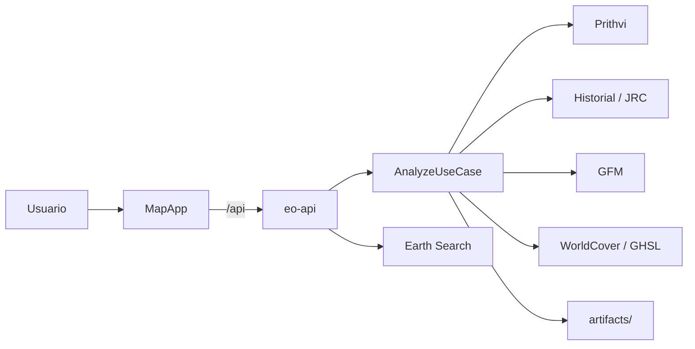
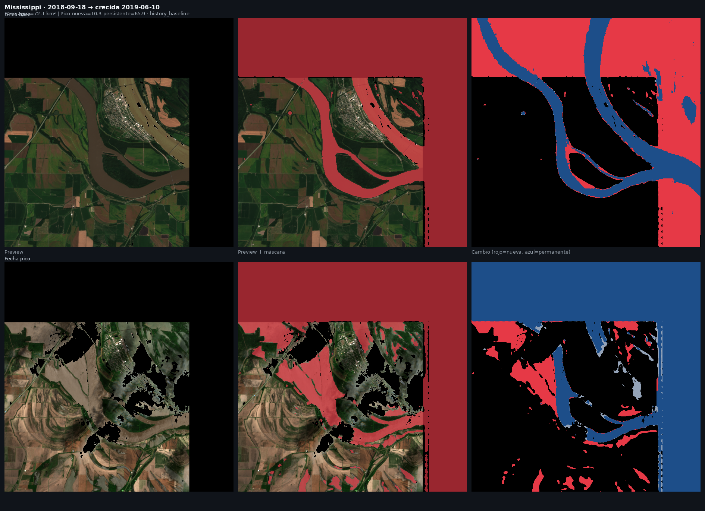

# Tune: análisis satelital de inundación como cambio hídrico con Prithvi-EO 2.0

Autores: Carlos Andrés Galvis Pájaro y Zenen Contreras Royero.  
Informe final, noviembre de 2026. Repositorio: https://github.com/Charlsz/Tune.

## Resumen / Abstract

Tune es un prototipo académico que convierte una escena Sentinel-2 (o un GeoTIFF de seis bandas Prithvi) en un **análisis recuperable de inundación**. El checkpoint publicado `ibm-nasa-geospatial/Prithvi-EO-2.0-300M-TL-Sen1Floods11` clasifica agua; la inundación se define como **agua nueva** frente a una referencia (historial del mismo territorio o Global Surface Water del European Commission's Joint Research Centre (JRC)). Cuando Copernicus Global Flood Monitoring (GFM) dispone de capa en la zona y fecha, Tune calcula el acuerdo (Intersection over Union (IoU)) y una imagen de fusión. La exposición cruza el agua nueva con WorldCover de la European Space Agency (ESA) y población del Global Human Settlement Layer (GHSL).

La solución es cliente-servidor (FastAPI + MapApp en React/Leaflet), desplegable con Docker Compose. La validación combina pruebas automáticas sin Graphics Processing Unit (GPU) ni red y corridas reales documentadas (p. ej. Sindh, Pakistán, mayo→septiembre 2022: agua detectada 10,34 → 60,22 km²; agua nueva en el pico ~49,56 km² con `history_baseline`). El prototipo no sustituye sistemas operativos de emergencia ni pronostica caudal; aporta un contrato auditable de las tres lecturas: agua detectada, agua nueva y acuerdo externo.

---

## 1. Introducción

Los foundation models geoespaciales desplazaron parte del trabajo práctico desde el preentrenamiento hacia el uso de pesos ya especializados. Prithvi-EO 2.0 y el checkpoint Sen1Floods11 de IBM–National Aeronautics and Space Administration (NASA) permiten detectar agua sobre escenas ópticas. El vacío que persiste es un sistema que reciba un raster o una coordenada, respete el procedimiento oficial de inferencia y deje un resultado **interpretado y recuperable**, sin presentar el cauce permanente como inundación.

El planteamiento inicial del proyecto correspondía a un laboratorio de Machine Learning Operations (MLOps) de fine-tuning. La orientación del curso y la viabilidad técnica llevaron a fijar tarea, dataset de procedencia, modelo y criterios verificables en una **aplicación de análisis**. Tune materializa esa orientación: inundación como cambio hídrico, búsqueda global por coordenada, fusión con GFM (Global Flood Monitoring) cuando hay dato y exposición a cobertura y población.

## 2. Marco conceptual

### 2.1 Raster, bandas Prithvi y segmentación

Una imagen operativa es un raster georreferenciado. Prithvi-EO 2.0 espera seis bandas (azul, verde, rojo, Near-Infrared (NIR) estrecho, Short-Wave Infrared 1 (SWIR1), Short-Wave Infrared 2 (SWIR2)). Tune acepta ese GeoTIFF o un Sentinel-2 del que extrae los índices correspondientes. La segmentación asigna clase por píxel; el área en km² se obtiene del tamaño de píxel por el conteo positivo, excluyendo nodata.

### 2.2 Foundation model y checkpoint

Tune consume, sin reentrenar, el checkpoint Sen1Floods11. La inferencia oficial recorta ventanas 512×512 y recompone la máscara (TerraTorch). El identificador del modelo viaja en cada análisis. El directorio `lab/` conserva material de fine-tuning fuera del núcleo evaluado.

### 2.3 Cambio hídrico, fusión y exposición

**Agua detectada** es la máscara del modelo. **Inundación** es el agua que no pertenece a la referencia permanente (occurrence del JRC (Joint Research Centre) ≥ 75 % o máscara previa del territorio con `acquired_at` anterior). **Fusión** alinea GFM (ensemble flood extent, SpatioTemporal Asset Catalog (STAC) del Earth Observation Data Centre (EODC), ventana ±10 días) a la grilla del análisis y calcula IoU (Intersection over Union) y residuales. **Exposición** agrega WorldCover y GHSL (Global Human Settlement Layer) sobre el agua nueva.

## 3. Planteamiento del problema

### 3.1 Descripción del problema

Disponer del modelo y del dataset no basta si el resultado no distingue cauce de desborde ni puede consultarse después. Scripts aislados producen máscaras sin contrato; laboratorios de entrenamiento no entregan análisis si la GPU (Graphics Processing Unit) no cierra. Quienes necesitan una lectura defendible de inundación carecen de un sistema integrado, portable y acotado.

### 3.2 Restricciones y supuestos de diseño

Prototipo académico (sin multi-tenancy, Open Authorization (OAuth) ni Service Level Agreement (SLA)). Un análisis a la vez en Central Processing Unit (CPU) tras cachear pesos. Datasets y productos públicos. Sin preentrenamiento de foundation models. Sin pronóstico hidrológico ni profundidad del agua. GFM y WorldCover pueden fallar sin tumbar el análisis.

### 3.3 Alcance

**Incluye:** ingesta GeoTIFF o catálogo Sentinel-2, inferencia Prithvi inundación, cambio frente a JRC/historial, fusión GFM, exposición, Application Programming Interface (API), MapApp (área → fechas → escenas → Antes/Después/Cambio/Acuerdo), Docker, pruebas de contrato, validación multi-sitio documentada. Cicatriz de incendio como tarea auxiliar.

**Excluye:** reentrenamiento como entregable, autenticación, colas, PostGIS (extensión espacial de PostgreSQL), anclar el producto a un solo territorio, User Interface (UI) legacy con router (conservada en código no montado).

## 4. Objetivos

**General.** Ejecutar el checkpoint Sen1Floods11 sobre GeoTIFF válido o escena Sentinel-2 de cualquier coordenada; persistir el análisis con el id del modelo; calcular agua nueva frente a JRC o historial; registrar acuerdo con GFM cuando exista capa; servir máscara, cambio, fusión y exposición por API (Application Programming Interface) y MapApp.

**Específicos.** (1) Contrato de entrada/salida y rechazos. (2) Integrar Prithvi con TerraTorch sin reentrenar. (3) Persistencia de cambio, fusión y exposición. (4) Catálogo STAC (SpatioTemporal Asset Catalog) y flujo Antes/Después. (5) Validar con pruebas sin red/GPU y corridas reales documentadas. En escena con cauce, permanente > 0 y nueva < detectada; la cifra defendible como inundación es el agua nueva.

## 5. Estado del arte / soluciones relacionadas

Prithvi-EO 2.0 (Szwarcman et al., 2024) y Sen1Floods11 (Bonafilia et al., 2020) fijan el detector. Global Surface Water (GSW) del JRC (Pekel et al., 2016) aporta permanente. Copernicus GFM, Observational Products for End-Users from Remote Sensing Analysis (OPERA) Dynamic Surface Water Extent (DSWx), Flood Hub y prácticas de United Nations Platform for Space-based Information for Disaster Management and Emergency Response (UN-SPIDER) cubren fragmentos operativos. Tune no los sustituye: aplica el checkpoint como agua detectada, lo corrige con permanente, lo confronta con radar cuando hay dato y agrega exposición, con contrato auditable en cualquier coordenada.

## 6. Solución propuesta

Tune es una aplicación de análisis satelital centrada en inundación. El operador elige un área y dos fechas; MapApp consulta Earth Search, analiza el par y muestra preview, máscara, **cambio** (rojo = nueva) y **acuerdo GFM** si hubo capa. El backend orquesta un único caso de uso hexagonal. El valor frente a un script es la interpretación (cambio + fusión + exposición), la degradación parcial y la reproducibilidad con Docker.

## 7. Metodología de desarrollo

Prototipado iterativo: cada ciclo dejó contrato, puerto, prueba o Architecture Decision Record (ADR). Iteraciones visibles en git: laboratorio hexagonal → app de inferencia (ADR 005) → cambio hídrico (ADR 010) → catálogo, fusión (ADR 014), exposición (ADR 015) → MapApp y validación multi-sitio. Validación continua con pytest/vitest en Continuous Integration (CI) y corridas documentadas con pesos cacheados.

## 8. Requerimientos

### 8.1 Funcionales

- Listar tarea inundación con id Hugging Face.
- Aceptar GeoTIFF o escena de catálogo (lat, lon, fechas, side_km).
- Persistir análisis con máscara, áreas, Coordinate Reference System (CRS), bounds, latencia, model_id.
- Incluir cambio (nueva/permanente/retirada) si hay referencia; fusión si GFM responde; exposición si WorldCover responde.
- MapApp: modos Antes, Después, Cambio, Acuerdo; métricas y overlays.
- Rechazar no-GeoTIFF, tareas desconocidas, tamaños excesivos; no inventar acuerdo sin GFM.

### 8.2 No funcionales

Docker Compose; pesos en volumen; CPU; dominio sin torch/rasterio; un análisis a la vez; sin autenticación; degradación parcial; suite automática sin red ni GPU.

## 9. Evaluación de alternativas

Se consideraron: (1) fine-tuning como núcleo, (2) solo cambiar dataset y seguir entrenando, (3) clasificador pequeño ajeno al dominio, (4) **checkpoints publicados + app de cambio/fusión/exposición** (seleccionada).

La opción 4 ofrece resultado demostrable en el calendario del curso, acoplamiento acotado por puertos y tolerancia a fallos parciales (análisis sin fusión/exposición). Detalle de criterios en el [Segundo Informe](./SegundoInforme.md#9-evaluación-de-alternativas).

## 10. Diseño y arquitectura

### 10.1 Arquitectura

Cliente-servidor en dos contenedores (nginx + FastAPI). Enfoque hexagonal: dependencias hacia el dominio; TerraTorch, STAC y rasterio en infraestructura.

#### 10.1.1 Descripción general

Un solo `AnalyzeUseCase` sirve API y MapApp. Inferencia en proceso (sin cola). Persistencia en `artifacts/analyses/<id>/`.

#### 10.1.2 Componentes e interacción

| Componente | Responsabilidad |
|---|---|
| MapApp | Flujo área→fechas→escenas; overlays; métricas; historial de sesión |
| eo-api | Validación Hypertext Transfer Protocol (HTTP), catálogo, orquestación |
| PrithviSegmenter | Ventanas 512×512, máscara |
| ReferenceProvider | Historial antes que JRC (Joint Research Centre) |
| ObservationProvider | GFM (Global Flood Monitoring); OPERA (Observational Products for End-Users from Remote Sensing Analysis) opcional |
| ExposureProvider | WorldCover + GHSL (Global Human Settlement Layer) |
| AnalysisRepository | JSON + PNG/TIF |

Diagramas canónicos (Mermaid):

- [Arquitectura](./assets/diagramas/arquitectura.md)
- [Interacción de módulos](./assets/diagramas/interaccion-modulos.md)
- [Secuencia de análisis](./assets/diagramas/secuencia-analisis.md)
- [Despliegue](./assets/diagramas/despliegue.md)

Figura — arquitectura (resumen):



#### 10.1.3 Comportamiento

El cuello de botella es la inferencia y la primera descarga de pesos (~1,2 GB). Lecturas remotas usan ventanas. GFM vacío → 201 sin `fusion`. PNG o 3 bandas → 400/422. Modelo caído → 503.

## 11. Implementación

### 11.1 Stack tecnológico

Python 3.11, FastAPI, TerraTorch/PyTorch, rasterio, pystac-client; TypeScript, React 19, Vite, Leaflet, Mapbox tiles; Docker Compose; pytest, vitest, ruff.

### 11.2 Componentes

Implementados: dominio Earth Observation (EO), `analyze`/`change`/`fusion`/`exposure`, adaptadores Prithvi/JRC/historial/GFM/WorldCover/GHSL/STAC, API de análisis y catálogo, MapApp con bridge API, fusión visible (IoU + capa Acuerdo), Docker CPU (GPU opcional). Single-Page Application (SPA) antigua no montada (`web/src/legacy/README.md`). Laboratorio en `lab/`.

### 11.3 Integraciones

Hugging Face, Earth Search, GSW del JRC, GFM vía EODC (`TUNE_OBSERVE_GFM=true`), WorldCover, GHSL. OPERA opcional (`EARTHDATA_TOKEN`). Mapbox token solo para basemap web.

## 12. Despliegue y operación

```bash
cp .env.example .env
make app-up    # o: docker compose up -d --build
```

| Servicio | Uniform Resource Locator (URL) |
|---|---|
| MapApp | http://localhost:8080 |
| API / Swagger | http://localhost:8000/docs |

Volumen `hf-cache` y carpeta `artifacts/` persisten pesos y análisis. Detalle: [Instalación.md](./Instalación.md). Diagrama: [despliegue](./assets/diagramas/despliegue.md).

## 13. Validación

### 13.1 Pruebas por componentes

Unitarias de cambio, fusión, exposición, observación (mocks), grilla y helpers Prithvi. Vitest: `apiBridge`, Area of Interest (AOI), reducer MapApp. CI (Continuous Integration) sin GPU ni red.

### 13.2 Pruebas de integración

API: tareas, análisis, artefactos, catálogo con dobles, rechazos. Segmentador real no se carga en CI; se ejerce en corridas locales con pesos cacheados.

### 13.3 Pruebas de usabilidad

**Método.** Recorrido guiado del flujo MapApp (una sesión, operadores del equipo): (1) localizar AOI (Area of Interest) Sindh, (2) fechas 2022-05-18 / 2022-09-05, (3) elegir escenas, (4) analizar, (5) interpretar modos Cambio y Acuerdo.

**Criterios.** Completar el par sin ambigüedad sobre qué cifra es inundación; ver overlay de cambio; entender ausencia de GFM si el botón Acuerdo está deshabilitado.

**Hallazgos.** El flujo área→fechas→escenas es comprensible. La métrica **Nueva** y el modo **Cambio** comunican inundación ≠ agua total. El historial de pestaña es solo de sesión (los análisis API no aparecen hasta analizar desde la UI) — documentado en la interfaz. Si GFM no aporta capa, el modo Acuerdo queda desactivado sin bloquear el resto (degradación prevista). Mapas de cambio: §13.4.

### 13.4 Controles multi-sitio (corrida real)

Protocolo: [validation/sitios.md](./validation/sitios.md). Pares: [casos-demostracion.md](./validation/casos-demostracion.md).

| Sitio | Base → pico | Detectada (km²) | Nueva pico (km²) | Persistente | Referencia |
|---|---|---:|---:|---:|---|
| Sindh, Pakistan (PK) | 2022-05-18 → 2022-09-05 | 10,34 → 60,22 | **49,56** | 10,03 | history_baseline |
| Magdalena, Colombia (CO) | 2022-02-22 → 2022-05-08 | ~22 → ~55 | ~38 | ~16 | history_baseline |
| Mississippi, United States (US) | 2018-09-18 → 2019-06-10 | ~72 → ~76 | ~10 | ~66 | history_baseline |

Detalle Sindh (ids de análisis y artefactos): [sitios-resultados.md](./validation/sitios-resultados.md).

#### Mapas de cambio (capa Cambio)

Rojo = agua nueva (cifra de inundación); azul = permanente respecto a la línea base.

**Sindh (PK) — pico frente a `history_baseline` (mayo 2022).** Coincide con ~49,56 km² nuevas.


**Magdalena (CO) — seca → húmeda.** Comparación del par que sostiene ~38 km² nuevas.


**Mississippi (US) — base → crecida.** Comparación del par que sostiene ~10 km² nuevas sobre cauce ya permanente.



#### Acuerdo GFM en esas corridas (no es un fallo del análisis)

En Sindh, `metadata.pipeline` quedó `reference: ok`, `exposure: ok` y **`observation: empty`**: Tune **sí consultó** Copernicus Global Flood Monitoring (GFM); el SpatioTemporal Asset Catalog (STAC) no devolvió una capa alineable al bbox/fecha de la escena (±10 días). Por eso `fusion` es `null` y no hay `fusion_png`.

Eso **no invalida** el resultado de inundación. La cifra defendible del prototipo es el **agua nueva** (cambio frente a historial/JRC), ya completa en esas corridas. GFM es un **contraste opcional** (ADR 014): cuando hay capa se muestra IoU; cuando no, el análisis se guarda igual. Causas habituales de `empty`: desfase óptico Sentinel-2 vs radar Sentinel-1, hueco de cobertura GFM en esa ventana, o indisponibilidad temporal del catálogo EODC — no un error de Prithvi ni del cálculo de cambio.

## 14. Resultados, discusión y conclusiones

Se cumplió el objetivo de servir un análisis de inundación como agua nueva, con API, MapApp, degradación parcial y evidencia empírica en al menos un sitio con pesos reales y tabla documentada. Las tres lecturas están implementadas; GFM se consulta automáticamente y se muestra cuando existe.

**Limitaciones.** El acuerdo GFM es condicional (cobertura/fecha/catálogo); no sustituye al agua nueva. Desfase óptico / Synthetic Aperture Radar (SAR). Población 0 en algunos recortes. Historial UI no lista aún `GET /api/analyses`. Sin autenticación ni escala multi-usuario.

**Conclusión.** Tune demuestra que un checkpoint publicado, interpretado con referencia permanente y contraste opcional con GFM, produce una lectura defendible de inundación en un prototipo reproducible, distinto de un laboratorio de entrenamiento o de un Geographic Information System (GIS) operativo completo.

## 15. Trabajo futuro

1. Cablear MapApp a historial/timeline API.  
2. Preflight de disponibilidad GFM y fallback STAC.  
3. Retirar o aislar físicamente la SPA legacy.  
4. Usabilidad con usuarios externos y métricas System Usability Scale (SUS).  
5. Despliegue en Virtual Machine (VM) con Hypertext Transfer Protocol Secure (HTTPS) y `API_BIND` restringido.  
6. Evaluación cuantitativa ampliada (IoU vs GFM cuando EODC responda de forma estable).

## 16. Referencias

1. Szwarcman, D., et al. (2024). Prithvi-EO-2.0. arXiv:2412.02732.  
2. IBM-NASA Geospatial. Prithvi-EO-2.0-300M-TL-Sen1Floods11. Hugging Face.  
3. Bonafilia, D., et al. (2020). Sen1Floods11. Conference on Computer Vision and Pattern Recognition Workshops (CVPRW).  
4. Pekel, J.-F., et al. (2016). High-resolution mapping of global surface water. Nature.  
5. Wagner, W., et al. The Sentinel-1 Global Flood Monitoring service. Remote Sensing of Environment (RSE).  
6. Copernicus Emergency Management Service (EMS). GFM (Global Flood Monitoring) Product User Manual.  
7. Zanaga, D., et al. (2022). ESA (European Space Agency) WorldCover 2021.  
8. Schiavina, M., et al. (2023). Global Human Settlement Population (GHS-POP) R2023A.  
9. UN-SPIDER (United Nations Platform for Space-based Information for Disaster Management and Emergency Response). Flood mapping recommended practice.  
10. GitHub. Tune. https://github.com/Charlsz/Tune.  
11. Architecture Decision Records (ADRs) del repositorio: `docs/decisions/` (005, 010, 014, 015, 016).  
12. Modelo de repositorio del curso: https://github.com/augustosalazar/pf_modelo_repositorio.
