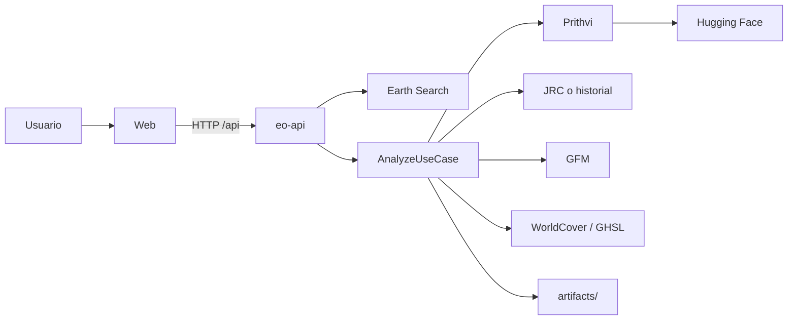
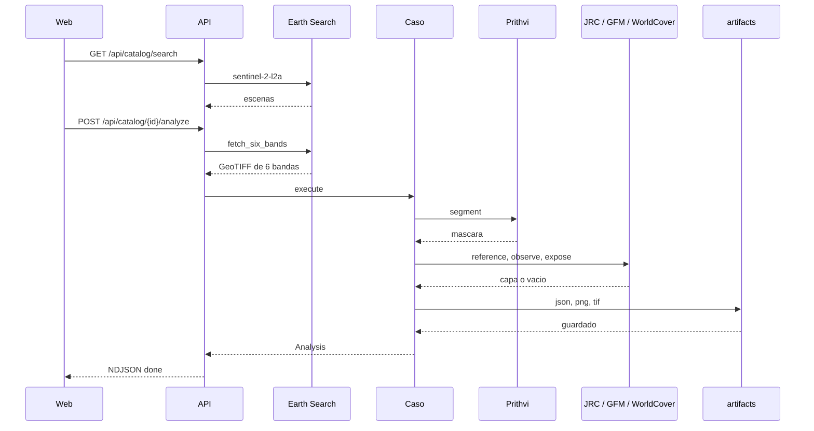
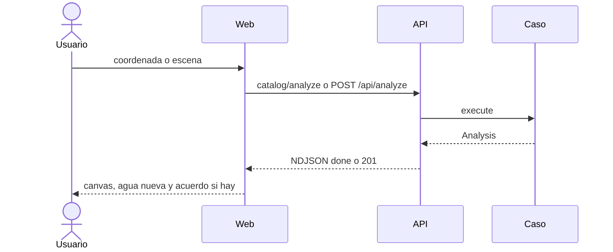
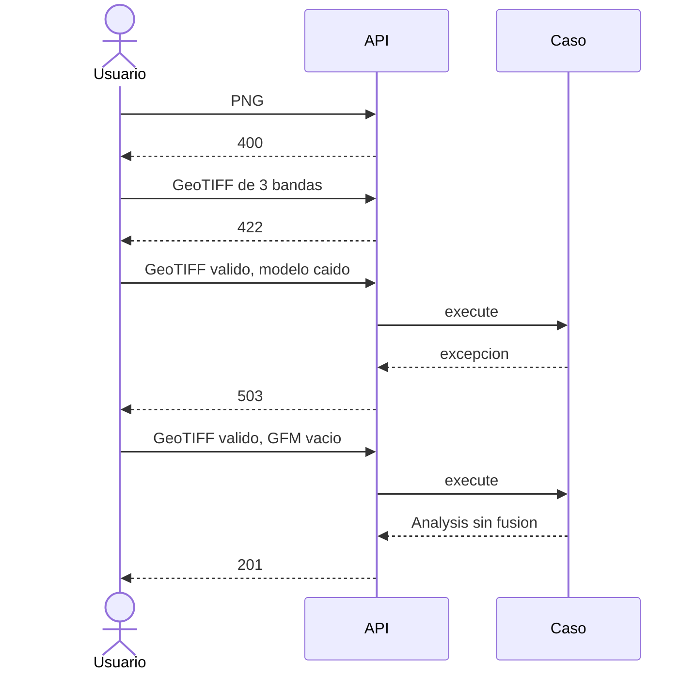

# Tune: análisis satelital de inundación como cambio hídrico con Prithvi-EO 2.0

Autores: Carlos Andrés Galvis Pájaro y Zenen Contreras Royero.
Tutor: Daniel Romero.
Segundo informe, octubre de 2026. Repositorio: https://github.com/Charlsz/Tune.

## Resumen / Abstract

Tune convierte una imagen satelital georreferenciada, o una escena Sentinel-2 localizada por coordenada, en un análisis recuperable de inundación. El checkpoint Prithvi-EO 2.0 especializado sobre Sen1Floods11 clasifica agua. La inundación se obtiene al restar el agua permanente, de modo que un cauce en época seca no se reporta como desborde.

La aplicación cliente-servidor, construida con FastAPI y React, ejecuta ese checkpoint, calcula el agua nueva frente a JRC Global Surface Water o al historial del mismo territorio, compara la máscara con Copernicus GFM cuando existe capa coincidente y resume cobertura ESA WorldCover y población GHSL sobre el agua nueva. El catálogo STAC y las capas de referencia cubren cualquier coordenada.

El prototipo dispone de pruebas automáticas sin GPU ni red, API documentada e interfaz que presenta agua detectada, agua nueva y acuerdo externo. Persiste completar la corrida con pesos reales sobre el protocolo multi-sitio y las capturas de usabilidad antes de la entrega final. La infraestructura admite cicatriz de incendio con el checkpoint Burn Scars como tarea auxiliar. El objeto de este avance es la inundación.

## 1. Introducción

Los foundation models geoespaciales desplazaron parte del trabajo práctico desde el preentrenamiento hacia el uso de pesos ya especializados. Prithvi-EO 2.0, TerraTorch y los repositorios Hugging Face de IBM-NASA publican un checkpoint listo para detectar agua sobre escenas ópticas asociadas a Sen1Floods11. El vacío que persiste es un sistema que reciba un raster, respete el procedimiento oficial de inferencia y deje un resultado recuperable.

Un script de inferencia produce una máscara y se detiene. Un laboratorio que compara estrategias de entrenamiento produce métricas si las corridas terminan, y no produce un análisis servido si la GPU no arranca. El planteamiento inicial del proyecto correspondía a ese laboratorio. La orientación posterior del curso exige tarea, dataset, modelo y criterios verificables, y exige además que el agua detectada no se presente como inundación sin referencia permanente.

Tune responde a ese marco. Compromete la tarea de inundación, Sen1Floods11 como procedencia de los pesos y el modelo publicado correspondiente. Define inundación como agua nueva frente a una referencia global, permite buscar cualquier coordenada y, cuando hay dato, confronta el resultado con GFM. Una escena válida produce un análisis con identificador de modelo, resumen de cambio y, si aplica, fusión y exposición, cubierto por pruebas de contrato.

## 2. Marco conceptual

La comprensión del problema y de la solución exige fijar tres grupos de términos. El primero describe el raster y la segmentación que exige Prithvi. El segundo describe el foundation model y el checkpoint publicado. El tercero describe el cambio hídrico, la fusión con productos operativos y la exposición.

Sin ese vocabulario, inundación, agua detectada y agua permanente se confunden en la lectura de resultados. Las fuentes de la sección 5 respaldan los productos externos nombrados en este marco.

Los bloques siguientes desarrollan cada grupo con el detalle necesario para interpretar la arquitectura y los objetivos.

### 2.1 Raster, bandas Prithvi y segmentación

Una imagen operativa es un raster georreferenciado con bandas espectrales, sistema de referencia y transformación afín. Prithvi-EO 2.0 espera seis bandas: azul, verde, rojo, infrarrojo cercano estrecho y dos infrarrojos de onda corta. Tune acepta un GeoTIFF de esas seis o un Sentinel-2 L1C del que extrae los índices correspondientes. Un RGB de tres canales se rechaza.

La segmentación semántica asigna una clase a cada píxel. El checkpoint de inundación distingue sin agua y agua. El área en kilómetros cuadrados se obtiene del tamaño de píxel por el recuento de la clase positiva, excluyendo nodata. Sin sistema de referencia hay máscara y no hay ubicación en mapa.

Tune no opera sobre fotografías arbitrarias. El porcentaje afectado del modelo es agua detectada. El visor presenta un overlay de esa máscara sobre la escena, no un GIS de propósito general.

### 2.2 Foundation model, checkpoint y procedimiento oficial

Un foundation model geoespacial aprende representaciones sobre series de observación terrestre y se especializa después. Un checkpoint es el par de pesos y configuración publicado. Tune consume, sin reentrenar, el checkpoint ibm-nasa-geospatial/Prithvi-EO-2.0-300M-TL-Sen1Floods11. La misma aplicación puede cargar el checkpoint Burn Scars para cicatriz de incendio sin alterar el problema central de inundación.

La inferencia oficial recorta ventanas de 512 por 512 y recompone la máscara. Tune porta esa lógica con TerraTorch. El identificador del modelo viaja en cada análisis persistido y deja el resultado trazable al checkpoint usado.

Entrenar Prithvi constituye un experimento de adaptación. Inferir con el checkpoint publicado constituye el problema de ingeniería que resuelve la aplicación. El directorio de laboratorio del repositorio permite comparar estrategias de entrenamiento fuera del núcleo de este avance.

### 2.3 Cambio hídrico, fusión y exposición

El checkpoint detecta agua en la fecha de la escena. La inundación se define como el agua detectada que no pertenece al agua permanente. El agua permanente proviene de JRC Global Surface Water, con umbral de occurrence del 75 por ciento, o del historial de análisis del mismo territorio. Productos operativos y prácticas UN-SPIDER emplean definiciones equivalentes. Tune aplica esa definición al checkpoint fundacional y la sirve por API e interfaz.

La fusión compara el agua de Tune con una capa operativa, por defecto el ensemble de Copernicus GFM, alineada a la misma grilla. El índice de Jaccard y los residuales cuantifican el acuerdo. La exposición cruza el agua nueva con ESA WorldCover 2021 y población GHSL 2020, y expresa el resultado en kilómetros cuadrados por clase de cobertura y en personas expuestas.

La arquitectura hexagonal mantiene el dominio libre de librerías de visión y raster. Si un proveedor falla, el análisis se guarda sin resumen de cambio, sin fusión o sin exposición, según el caso.

## 3. Planteamiento del problema

El problema central es la ausencia de un sistema que, a partir de checkpoints publicados, produzca un análisis de inundación interpretado y recuperable. Disponer del modelo y del dataset no basta si el resultado no distingue cauce de desborde ni puede consultarse después.

La relevancia para Ingeniería de Sistemas reside en el contrato de datos y en la arquitectura que lo materializan, no en el reentrenamiento de Prithvi.

El Primer Informe conserva el planteamiento original del semestre. Esta sección actualiza el problema, las restricciones y el alcance vigentes.

### 3.1 Descripción del problema

Producir un mapa de inundación a partir de una escena satelital exige coordinar raster, modelo, georreferencia y un medio de consulta. En un entorno académico ese trabajo se fragmenta entre el fine-tuning prolongado, que no entrega producto si la corrida no cierra, y el script de una sola ejecución, que deja un archivo en disco sin servicio. El planteamiento inicial de Tune correspondía al primer camino y heredaba ambas limitaciones.

Las causas son tres. El costo de reentrenar del orden de trescientos millones de parámetros pospone el resultado a la disponibilidad de GPU. Las herramientas existentes cubren fragmentos y no unen validación de entrada, inferencia, resta de agua permanente, comparación con un producto operativo y persistencia. Presentar el agua detectada como inundación genera falsos positivos sistemáticos en ríos y ciénagas.

El problema afecta a quienes deben demostrar un flujo completo de análisis satelital sin plataforma enterprise y sin semanas de cómputo. El estado resultante es que el modelo y el dataset existen, pero no hay un análisis defendible como inundación ni recuperable al día siguiente. La carencia operativa es el flujo que valida, interpreta y sirve.

### 3.2 Restricciones y supuestos de diseño

El proyecto se desarrolla como prototipo académico. Carece de autenticación, cola de trabajos y acuerdo de nivel de servicio. Los pesos se descargan de Hugging Face en la primera inferencia, del orden de 1,2 GB, y se cachean. Sin red en esa primera corrida no hay inferencia. La entrada válida es un GeoTIFF de seis bandas, un L1C amplio o una escena L2A del catálogo Earth Search. La ejecución cabe en CPU. Se procesa un análisis a la vez.

Se asume cobertura de JRC Global Surface Water y WorldCover 2021 sobre el área pedida. GFM cubre tierra no polar con Sentinel-1. Si no hay ítem en la ventana temporal, la fusión queda vacía y el análisis se guarda. OPERA DSWx exige token Earthdata y permanece desactivado por defecto. Sentinel-2 L2A no equivale a L1C. El sesgo se declara.

La entrada es un raster de contrato. La salida es máscara, resumen de cambio si hay referencia, fusión si hay capa externa y exposición si WorldCover responde. El modelo no se entrena durante la ejecución del prototipo. Quedan fuera del diseño bases espaciales, estimación de profundidad del agua y pronóstico hidrológico.

### 3.3 Alcance actualizado

Respecto al planteamiento del primer informe, el núcleo deja de ser el laboratorio que compara estrategias de entrenamiento y promueve un alias. El alcance vigente es la aplicación de análisis de inundación con definición de cambio hídrico. El directorio de laboratorio permanece en el repositorio fuera de la evaluación de este avance.

El alcance incluye ingesta de GeoTIFF o escena Sentinel-2 por coordenada, tarea de inundación con el checkpoint Sen1Floods11, inferencia en ventanas de 512 por 512, agua nueva frente a JRC o historial, serie y sectores del territorio, fusión con GFM, exposición WorldCover y GHSL, API, interfaz web, Docker y pruebas sin red ni GPU. Incluye además cicatriz de incendio como tarea auxiliar sobre el mismo flujo. No restringe el producto a un territorio único.

Quedan fuera del alcance el reentrenamiento como entregable, el pronóstico hidrológico, la profundidad del agua, la autenticación de usuarios, las colas de trabajo y la orquestación en la nube. El resultado esperado del ciclo es un prototipo centrado en inundación, con fusión y exposición condicionadas a la disponibilidad de datos externos.

## 4. Objetivos

Los objetivos se formulan como resultados experimentales reproducibles. Incluyen tarea, dataset de procedencia, modelo y umbrales.

El objetivo general consiste en ejecutar el checkpoint publicado de inundación sobre un GeoTIFF válido o una escena Sentinel-2 de cualquier coordenada, persistir el análisis con el identificador de ese checkpoint, calcular el agua nueva frente a JRC o historial cuando la referencia exista, registrar el acuerdo con GFM cuando el producto responda, y servir máscara, cambio, fusión y exposición mediante la API.

La tarea es inundación. El dataset de procedencia es Sen1Floods11. El modelo es ibm-nasa-geospatial/Prithvi-EO-2.0-300M-TL-Sen1Floods11. Bajo las mismas condiciones se registran tres lecturas: el agua del modelo, el agua nueva frente a permanente, que constituye la cifra de inundación, y el acuerdo con GFM cuando hay capa. En escena con cauce visible, el área permanente es mayor que cero y el agua nueva es menor que el agua detectada. En río en seca, el cociente entre agua nueva y agua detectada es menor que 0,15. El índice de Jaccard se registra si GFM responde. Se procesa un análisis a la vez en CPU tras cachear pesos.

Los objetivos específicos son fijar el contrato de entrada y salida, integrar el checkpoint con TerraTorch sin reentrenar, calcular y persistir el cambio frente a referencia, calcular la fusión contra GFM cuando exista ítem, exponer el agua nueva sobre WorldCover y GHSL, servir el caso de uso por API e interfaz con catálogo, y validar con pruebas sin red y con corridas documentadas sobre la API. Bajo las mismas condiciones deben registrarse las tres lecturas, defenderse como inundación únicamente el agua nueva y rechazarse archivos que no sean GeoTIFF y tareas desconocidas.

## 5. Estado del arte / soluciones relacionadas

La revisión se limita a las fuentes necesarias para nombrar modelo, dataset y productos operativos relacionados con Tune.

Prithvi-EO 2.0, publicado por Szwarcman y colaboradores en 2024, y el repositorio Hugging Face de inundación de IBM-NASA fijan el detector. Sen1Floods11, de Bonafilia y colaboradores en 2020, es la procedencia de los pesos. JRC Global Surface Water, de Pekel y colaboradores en 2016, aporta la referencia de agua permanente. Copernicus GFM documenta extensión de inundación a escala global con Sentinel-1. ESA WorldCover 2021 y GHSL 2020 aportan cobertura y población. UN-SPIDER documenta el cruce de extensión con exposición. Esas fuentes sitúan a Tune entre la detección de agua y el mapeo de inundación.

Copernicus GFM, NASA OPERA DSWx, Google Flood Hub, MapBiomas Agua, HydraFloods y las prácticas en Earth Engine cubren fragmentos del problema operativo. UNGRD e IDEAM consumen productos externos u operan sistemas hidrológicos. No reentrenan un foundation model en cada emergencia.

Tune no sustituye esos sistemas. Aplica el checkpoint fundacional como agua detectada, lo corrige con agua permanente, lo confronta con un producto de radar cuando hay dato y lo agrega por clase de suelo y población, en cualquier coordenada, con un contrato auditable.

## 6. Solución propuesta

Tune es una aplicación de análisis satelital centrada en inundación. Recibe un GeoTIFF o una escena del catálogo Earth Search en cualquier latitud y longitud, ejecuta el checkpoint publicado de inundación y devuelve máscara, estadísticas, agua nueva frente a referencia cuando existe, acuerdo con GFM cuando hay capa y exposición cuando WorldCover responde.

El enfoque consiste en consumir especialización publicada e interpretarla. IBM-NASA publicó los pesos. Tune descarga, infiere y persiste. JRC y el historial aportan el agua permanente. GFM aporta una segunda observación cuando está disponible. WorldCover y GHSL traducen el agua nueva a cobertura y población. El operador obtiene kilómetros cuadrados nuevos y, si hay dato, acuerdo y población, sin fine-tuning y sin pronóstico.

El flujo comprende entrada válida, validación de bandas, inferencia Prithvi, agua detectada, referencia, resumen de cambio, observación GFM, fusión, exposición, persistencia en disco y consulta por API o web. La verificación consiste en analizar una escena oficial o una coordenada, observar el agua nueva cuando hay referencia y comprobar el rechazo de un archivo que no sea GeoTIFF.

## 7. Metodología de desarrollo

Se adoptó prototipado iterativo porque el sistema mezcla raster, modelo, API e interfaz. Cada ciclo deja un contrato, un puerto, una prueba automatizada o una decisión registrada, y se ajusta cuando el código o la revisión del curso contradicen el plan.

Las iteraciones del semestre, visibles en el historial de git, abarcaron laboratorio de fine-tuning y arquitectura hexagonal, aplicación de inferencia con checkpoints publicados, metadatos, timeline y búsqueda por coordenada, retiro del pronóstico externo, definición de inundación como cambio, JRC, historial, serie y sectores, catálogo STAC, fusión GFM, exposición global y validación multi-sitio.

La validación de cada ciclo combina pruebas automáticas en integración continua, sin GPU y sin red, y revisión del flujo en la interfaz. El checkpoint detecta agua. El mosaico WorldPop no admite lectura por rangos HTTP, por lo que se eligió GHSL. OPERA exige token y permanece opcional. La prioridad es un análisis defendible en cualquier coordenada, seguido del pulido de interfaz, sin reabrir pronóstico ni anclar el producto a un municipio.

## 8. Requerimientos

Los requerimientos fijan el comportamiento del sistema y sus atributos de calidad. Se separan en funcionales y no funcionales para contrastar implementación y pruebas con criterios explícitos.

Los funcionales describen comportamientos observables en API e interfaz. Los no funcionales acotan reproducibilidad, portabilidad, mantenibilidad y el tamaño del prototipo académico.

Ambos conjuntos se relacionan con la arquitectura, la implementación y la validación.

### 8.1 Funcionales

El sistema lista la tarea de inundación con el identificador Hugging Face del checkpoint. Acepta GeoTIFF o escena del catálogo por latitud, longitud y fechas, y persiste un análisis con identificador, máscara, área, sistema de referencia, caja geográfica, latencia e identificador de modelo.

Si hay referencia, el análisis incluye resumen de cambio, agua nueva, permanente y retirada, con imagen de cambio. Si GFM responde, incluye fusión con índice de acuerdo e imagen de acuerdo. Si WorldCover responde, incluye exposición con clases y población. Ofrece historial, línea temporal, serie, diferencia y sectores.

Rechaza archivos que no sean GeoTIFF, tareas desconocidas, tamaños excesivos y modelo no cargado. La interfaz muestra overlay y cifras cuando existen. No inventa coordenadas sin sistema de referencia ni acuerdo sin respuesta de GFM.

### 8.2 No funcionales

El sistema se levanta con Docker Compose y cachea pesos entre reinicios. La ejecución cabe en CPU. El dominio no importa librerías de visión ni raster. Un proveedor caído no borra el análisis.

Se acepta un análisis a la vez, sin autenticación ni servicio de producción. Los análisis antiguos cargan aunque falten campos opcionales. La barra de pruebas automáticas se ejecuta sin red ni GPU.

La reproducibilidad y la portabilidad fijan el despliegue del prototipo. La mantenibilidad se verifica mediante dobles del segmentador y del catálogo en pruebas. El desempeño y la seguridad se declaran al tamaño académico del sistema.

## 9. Evaluación de alternativas

Bajo la carga de un operador y un análisis se consideraron cuatro caminos. El primero es fine-tuning propio como núcleo. El segundo cambia solo el dataset y sigue entrenando. El tercero es un clasificador pequeño en CPU, ajeno al dominio satelital de seis bandas. El cuarto, seleccionado, combina checkpoints publicados con aplicación de cambio, fusión y exposición.

El primero no entrega análisis si la corrida no cierra. El segundo mejora la pertinencia de datos y conserva la dependencia de GPU. El tercero es rápido y no resuelve georreferencia, catálogo ni referencia permanente. El cuarto compromete tarea, dataset y modelo, corre en CPU tras cachear pesos y entrega cifras de agua nueva, acuerdo y población.

El laboratorio permanece como anexo. El entregable demostrable del ciclo es la aplicación de análisis. Los criterios siguientes se aplican a esa carga, no a un millar de usuarios concurrentes.

### Cuál alternativa ofrece mejor desempeño bajo carga esperada

La operación crítica es el análisis por API o desde catálogo. Las alternativas de entrenamiento no sirven inferencia si el entrenamiento no terminó. El clasificador pequeño responde rápido a otro problema. La alternativa seleccionada tiene latencia dominada por la primera descarga de pesos y por las ventanas de 512 por 512. JRC, GFM y WorldCover leen ventanas remotas, no tiles completos.

El throughput concurrente no es el criterio decisivo. Se acepta un análisis a la vez, con el modelo cacheado en proceso. El comportamiento bajo carga se degrada a espera o rechazo, no a corrupción del historial ya persistido.

El criterio relevante es el tiempo hasta un análisis visible con agua nueva cuando la referencia responde. En ese sentido, la alternativa seleccionada produce resultado demostrable en el calendario del proyecto.

### Qué grado de acoplamiento introduce cada opción

La alternativa seleccionada depende de Hugging Face, TerraTorch, JRC, Earth Search, GFM y, si se enciende, Earthdata. Cada dependencia está detrás de un puerto. Un fallo externo no tumba el resto del análisis. El acoplamiento interno es bajo. En pruebas, dobles sustituyen los adaptadores reales.

El camino de entrenamiento acopla el entregable al hardware y al tiempo de corrida. El clasificador pequeño abandona el dominio satelital. Sustituir el frontend o el repositorio en disco no exige tocar Prithvi. Sustituir Prithvi exige respetar el puerto y el contrato de seis bandas.

La facilidad de sustitución de componentes es mayor en la alternativa seleccionada que en un monolito de entrenamiento. La frontera hexagonal limita el radio de cambio.

### Qué nivel de disponibilidad y tolerancia a fallos ofrece cada alternativa

Ninguna alternativa ofrece tiempo de disponibilidad contractual. El prototipo corre en la máquina local mientras Docker está levantado.

En la alternativa seleccionada, si Hugging Face no responde en la primera corrida no hay inferencia nueva y el historial previo sigue. Si JRC o GFM fallan, el análisis se guarda sin cambio o sin fusión. Si WorldCover falla, sin exposición. Entradas inválidas se rechazan con códigos HTTP explícitos. La persistencia son carpetas en disco.

En el camino de entrenamiento, un fallo de memoria o de corrida deja cero producto de análisis. El impacto de fallos parciales en la alternativa seleccionada se acota a la capa que falló. Por ello se selecciona: produce un análisis verificable con las tres lecturas y con degradación parcial explícita.

## 10. Diseño y arquitectura

El sistema se estructura como cliente-servidor con caso de uso único y proveedores sustituibles. La descripción general precede a los componentes, a su interacción y a las secuencias de comportamiento.

Los diagramas aparecen al cierre de cada subsección correspondiente. Materializan la alternativa seleccionada en la sección 9.

### 10.1 Descripción general de la arquitectura

Tune es una arquitectura cliente-servidor en dos contenedores. Nginx sirve el frontend en el puerto 8080. FastAPI orquesta el caso de uso de análisis en el puerto 8000. No es Backend as a Service. La inferencia corre en el mismo proceso, sin cola, coherente con un análisis a la vez.

El enfoque es hexagonal. Las dependencias apuntan al dominio. TerraTorch, rasterio y el cliente STAC viven en infraestructura. La alternativa seleccionada se materializa en el segmentador Prithvi, el proveedor de referencia JRC, el proveedor de observación GFM y el proveedor de exposición.

El resto de la aplicación no conoce nombres de archivos de pesos ni URLs de tiles. Esa separación permite probar el contrato sin red ni GPU y sustituir un proveedor sin rediseñar el dominio.

### 10.2 Componentes del sistema

Los componentes principales se agrupan en cliente, API, caso de uso, adaptadores de infraestructura y persistencia. La web cubre carga, catálogo, visor, estadísticas e historial. La API valida HTTP y expone el contrato.

El caso de uso orquesta segmentar, cambio, fusión, exposición y persistencia. El segmentador carga pesos y aplica ventanas de 512 por 512. Los proveedores de referencia, observación y exposición cubren el cambio hídrico, el acuerdo externo y la traducción a cobertura y población. El catálogo habla con Earth Search. El repositorio en disco persiste cada análisis. El volumen de pesos guarda los checkpoints. La línea de comandos reutiliza el mismo caso de uso.

No hay base de datos espacial. El historial es el sistema de archivos. Los servicios externos se invocan solo desde infraestructura.

Figura 1. Arquitectura de Tune.

### 10.3 Interacción entre módulos

El navegador llama a la API. El router valida, escribe un temporal o pide al catálogo las seis bandas, y llama al caso de uso. El segmentador produce el agua detectada. El caso de uso solicita referencia, observación y exposición después de tener máscara. Cada una puede devolver vacío. El repositorio escribe JSON e imágenes. Las descargas posteriores son archivos estáticos.

Las dependencias van de interfaz a aplicación a dominio. Infraestructura implementa puertos. El acoplamiento entre tareas es bajo. Inundación es el camino principal. La cicatriz de incendio reutiliza el mismo caso de uso con otro checkpoint.

El nivel de acoplamiento se verifica en pruebas. La API se ejercita con segmentador falso. Fusión y exposición se prueban con arreglos sintéticos, sin red.

Figura 2. Interacción entre módulos.

### 10.4 Comportamiento

La secuencia nominal elige escena, infiere, resta agua permanente, fusiona si hay GFM, expone, guarda y pinta. El cuello de botella es la inferencia y, en la primera corrida, la descarga de pesos. Las lecturas remotas usan ventanas, no la descarga íntegra de tiles grandes.

Un solo caso de uso sirve API e interfaz. Cuando un proveedor cae, el análisis se guarda sin esa capa y el historial previo permanece.

Un PNG se rechaza. Bandas incorrectas se rechazan. Modelo no cargado responde con error de servicio. GFM caído deja el análisis sin fusión. JSON antiguo carga campos opcionales vacíos.

Figura 3. Análisis válido.

Figura 4. Rechazo y fallo parcial.

## 11. Implementación y avance actual

El estado de construcción se describe por stack, componentes implementados, integraciones externas y pendientes hacia la entrega final.

El avance se mide por lo presente en el repositorio y por las pruebas de contrato. La evidencia empírica pendiente se declara en 11.4.

### 11.1 Stack tecnológico

El backend usa Python 3.11 con FastAPI, Typer, TerraTorch, rasterio, cliente STAC, NumPy y Pillow. El frontend usa TypeScript, React 19 y Vite. El despliegue local usa Docker Compose. Las pruebas usan pytest y ruff.

No hay PostgreSQL. El historial es una carpeta por análisis. Las fuentes externas son Hugging Face, JRC, Earth Search, GFM, WorldCover y GHSL. Se leen por ventana o por API de búsqueda.

La elección es coherente con la alternativa seleccionada: un solo lenguaje de servidor, sin base espacial y dependencias externas detrás de puertos.

### 11.2 Componentes implementados

En dominio están las entidades de análisis, cambio, fusión, exposición y los puertos. En aplicación están el caso de uso, la comparación frente a referencia, la fusión, la exposición, la serie y los sectores. En infraestructura están el segmentador Prithvi, el repositorio en disco, los proveedores JRC e historial, el catálogo STAC, la observación GFM, WorldCover, GHSL y el contenedor de composición.

La API expone tareas, ejemplos, análisis, catálogo, línea temporal, serie, diferencia, sectores y artefactos. La web cubre carga, catálogo, visor con pestañas de escena, clases, cambio y acuerdo, panel de estadísticas e historial. Docker tiene perfil CPU y perfil GPU.

La suite de pruebas sin GPU pasa en el entorno de desarrollo. El flujo completo con pesos reales se ejerce cuando los pesos están cacheados.

### 11.3 Integraciones realizadas

Las integraciones externas cableadas son Hugging Face, Earth Search, JRC Global Surface Water, GFM en EODC, WorldCover 2021 y GHSL 2020. OPERA STAC está implementado y permanece opcional por token Earthdata.

No hay autenticación de usuarios ni integración on-demand con Copernicus EMS. Cada integración está detrás de un puerto. Si falla, el análisis se guarda sin esa capa.

La degradación parcial evita acoplar el núcleo a un solo proveedor externo.

### 11.4 Pendientes para la entrega final

Persisten la corrida con pesos reales, la tabla de controles con valores, las capturas de usabilidad del visor y el informe final.

Quedan fuera de este cierre el fine-tune de dominio y la estimación de profundidad. Una escena local solo entra si cumple bandas y sistema de referencia, y solo después de la corrida documentada.

La interfaz distingue agua detectada, agua nueva y acuerdo. Falta completar los números de la corrida documentada.

## 12. Despliegue y operación preliminar

El entorno de ejecución es Docker Compose en una máquina con Docker y memoria suficiente. No hay hosting de pago ni dominio propio.

Para levantar la aplicación se copia el archivo de entorno de ejemplo y se ejecuta make app-up. Para seguir la primera descarga de pesos se usa make app-logs. Para apagar se usa make app-down.

La API queda en el puerto 8000. La web queda en el puerto 8080. El volumen de pesos guarda los checkpoints. Los análisis quedan en disco. El detalle operativo está en el documento de instalación. No hay HTTPS público ni rearranque automático en un servidor ajeno.

## 13. Validación preliminar

La validación combina pruebas automáticas de contrato y un protocolo de controles multi-sitio pendiente de llenar con pesos reales. Se organiza en componentes, integración y usabilidad.

Las pruebas automáticas verifican rechazo, compatibilidad y cálculo de cambio, fusión y exposición con datos sintéticos. No sustituyen una corrida con el checkpoint real sobre escenas documentadas.

La corrida real cierra el aporte empírico frente a los umbrales de la sección 4. El protocolo está escrito en la documentación de validación.

### 13.1 Pruebas por componentes

Las pruebas unitarias cubren la matemática y los proveedores sin red. Los conteos de cambio, fusión y exposición se ejercen con arreglos sintéticos. Los proveedores usan sustitución de lectura remota.

Las pruebas de grilla usan GeoTIFF sintéticos locales. La integración continua ejecuta la suite sin GPU. Esas pruebas garantizan el contrato del sistema.

Un cambio de esquema o de conteo se detecta sin GPU ni red.

### 13.2 Pruebas de integración

Las pruebas de API verifican listado de tareas, creación de análisis, artefactos, catálogo con catálogo falso y rechazo de entradas inválidas. El segmentador real no se carga. La integración prueba HTTP y el caso de uso.

La especificación OpenAPI exige resumen y descripción en cada ruta publicada. Un análisis antiguo sin fusión o exposición sigue cargando.

El cumplimiento de rechazos y compatibilidad se verifica de forma automática.

### 13.3 Pruebas de usabilidad

El guion consiste en abrir la web, analizar la escena oficial de inundación en España o buscar una latitud y longitud, ver la máscara, la pestaña de cambio y, si hay fusión, el acuerdo. El diseño es una sola pantalla, sin autenticación.

Aún no hay pasada registrada con capturas. Los controles de coherencia están documentados en el protocolo multi-sitio.

Ese protocolo define casos de prueba para repetir umbrales. La aplicación acepta cualquier coordenada en el catálogo.

## 14. Resultados parciales y discusión

El resultado parcial principal es que el sistema expresa en código, API e interfaz las tres lecturas de inundación, agua detectada, agua nueva y acuerdo externo, junto con la exposición, con compatibilidad hacia atrás y pruebas de contrato en verde. Los objetivos de integración y servicio están implementados. La corrida real documentada con tabla llena permanece pendiente.

El desplazamiento desde el laboratorio hacia la aplicación de cambio responde al compromiso de tarea, dataset y modelo, y a la exigencia de no presentar el cauce como inundación. La interfaz prioriza el agua nueva cuando hay referencia.

Tune no sustituye a GFM, no pronostica caudal, no mide profundidad y no está calibrado para un solo humedal. Opera sobre cualquier coordenada y se valida con controles declarados. Los riesgos operativos, nubosidad, ausencia de ítem GFM y sesgo entre productos ópticos, se reconocen.

## 15. Plan de cierre hacia la entrega final

Las actividades restantes son la corrida con pesos cacheados y la tabla de controles, las capturas de usabilidad del visor y el informe final. Una escena local solo entra si el GeoTIFF cumple bandas y sistema de referencia.

Los riesgos son falta de red en la primera descarga de pesos, nubosidad en fechas candidatas, ausencia de ítem GFM en la ventana temporal y sesgo entre L2A y L1C. La mitigación consiste en pre-cachear pesos, ampliar ventanas de búsqueda cuando haga falta y reportar el acuerdo o la ausencia de dato.

El cierre se considera alcanzado cuando Docker levanta la aplicación, el agua nueva se sostiene como inundación en la interfaz y en la tabla de controles, el acuerdo se registra cuando existe, el protocolo multi-sitio tiene valores y el informe final describe la solución de forma autónoma.

## 16. Referencias

1. Szwarcman, D., Roy, S., Fraccaro, P., et al. (2024). Prithvi-EO-2.0: A Versatile Multi-Temporal Foundation Model for Earth Observation Applications. arXiv:2412.02732.
2. IBM-NASA Geospatial. Prithvi-EO-2.0-300M-TL-Sen1Floods11. Hugging Face.
3. IBM-NASA Geospatial. Prithvi-EO-2.0-300M-BurnScars. Hugging Face.
4. Bonafilia, D., Tellman, B., Anderson, T., y Issenberg, E. (2020). Sen1Floods11. CVPRW.
5. Phillips, C., Roy, S., Ankur, K., y Ramachandran, R. (2023). HLS Foundation Burnscars Dataset.
6. Pekel, J.-F., Cottam, A., Gorelick, N., y Belward, A. S. (2016). High-resolution mapping of global surface water. Nature, 540, 418 a 422.
7. Wagner, W., et al. (2026). The fully-automatic Sentinel-1 Global Flood Monitoring service. Remote Sensing of Environment.
8. Copernicus EMS. GFM Product User Manual v4.0 (2025).
9. NASA JPL. OPERA DSWx product suite.
10. Zanaga, D., et al. (2022). ESA WorldCover 10 m 2021 v200.
11. Schiavina, M., et al. (2023). GHS-POP R2023A.
12. UN-SPIDER. Recommended practice: flood mapping with Sentinel-1 in Google Earth Engine.
13. Rojas Sánchez, D. S. (2025). Trabajo de grado, Universidad de los Andes.
14. Sculley, D., et al. (2015). Hidden Technical Debt in Machine Learning Systems. NeurIPS.
15. GitHub. Tune. https://github.com/Charlsz/Tune.
