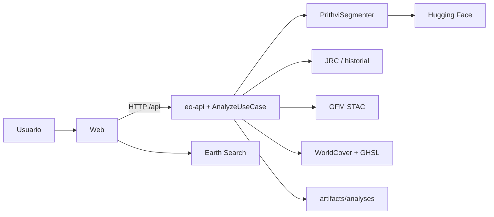
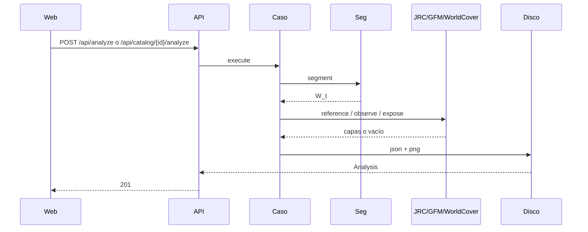
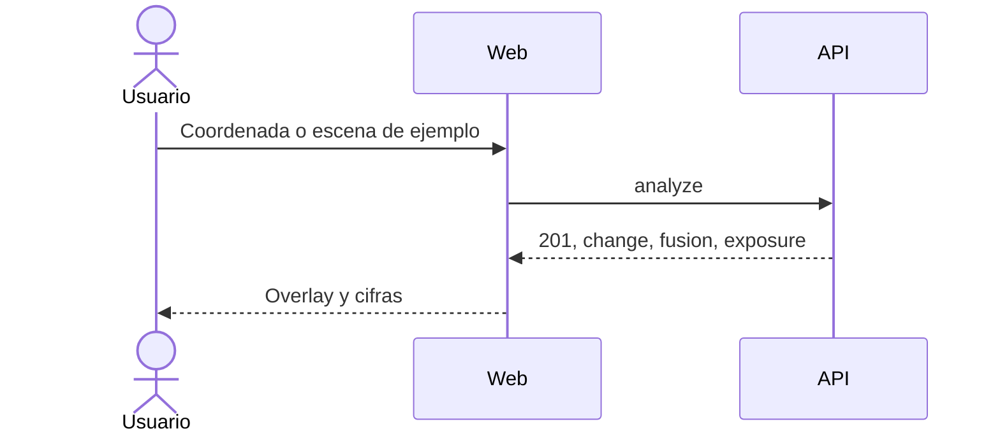
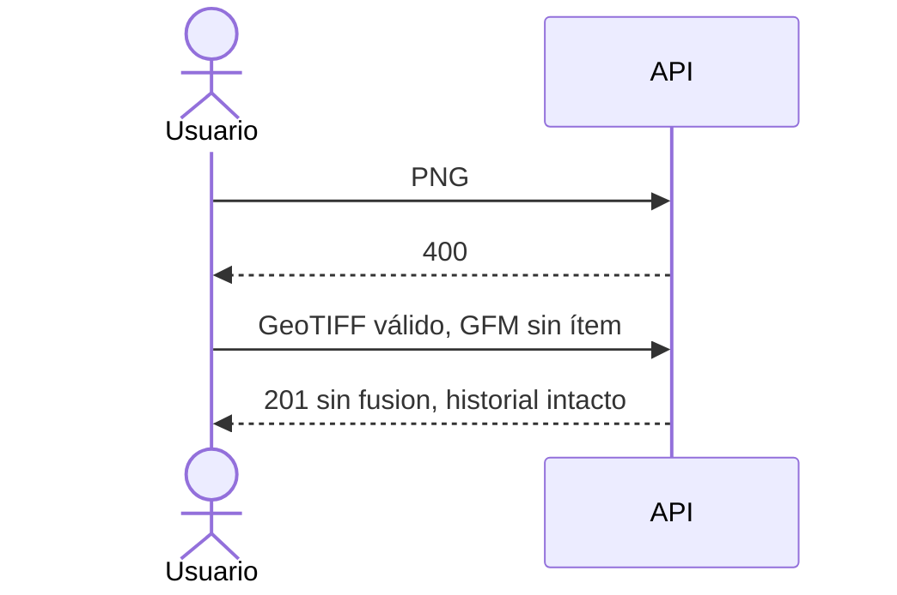

# Tune: análisis satelital de inundación como cambio hídrico, con Prithvi-EO 2.0

**Autores:** Carlos Andrés Galvis Pájaro y Zenen Contreras Royero
**Tutor:** Daniel Romero
**Segundo informe** · octubre de 2026 · repositorio [tune](https://github.com/Charlsz/Tune)

Presentamos la solución vigente del proyecto. El [Primer Informe](./PrimerInforme.md) queda como planteamiento original, congelado el 2026-08-29. El ajuste de alcance se justifica en la sección 3.3 y se mantiene en los objetivos, la solución, las alternativas y los resultados.

## Resumen / Abstract

El problema que abordamos ya no es el costo de reentrenar un modelo. Es producir, a partir de una escena satelital, un análisis de inundación o de cicatriz de incendio que se pueda abrir otra vez y que no llame inundación al cauce. El checkpoint publicado `Prithvi-EO-2.0-300M-TL-Sen1Floods11` clasifica agua. Sin una referencia de agua permanente, un río en época seca queda etiquetado como área inundada. Esa distinción —detectar agua, mapear el agua nueva y pronosticar caudal— organiza todo el alcance que sigue.

La solución vigente es una aplicación cliente-servidor (FastAPI y React). Recibe un GeoTIFF de seis bandas o una escena Sentinel-2 L2A buscada por coordenada, ejecuta el checkpoint publicado de la tarea (`flood` o `burn_scar`) y calcula el cambio frente a una referencia: en inundación, \(F_t = W_t \land \lnot P\), con \(P\) el agua permanente de JRC Global Surface Water (occurrence ≥ 75 %) o, si esa capa no responde, el historial del mismo territorio; en cicatriz, la referencia es ese historial. Cuando Copernicus GFM devuelve un ítem, el sistema registra el acuerdo con la máscara. El agua nueva se cruza con ESA WorldCover 2021 y con población GHSL 2020. La serie ordena las escenas del lugar por fecha de adquisición y los sectores de cerca de 1 km se rankean por kilómetros cuadrados nuevos. El pronóstico de caudal queda fuera: no sale de la imagen ni del modelo.

El estado del desarrollo es un prototipo de extremo a extremo. La batería `pytest -m "not gpu"` reúne 139 pruebas, sin GPU y sin red. La API está documentada, la web muestra catálogo, overlay y el bloque frente a referencia, y un `analysis.json` anterior sigue abriendo. La validación con pesos reales (`make validate-sites`) todavía no tiene la tabla de pasó o no pasó llena. El protocolo y los controles ya están escritos. Esa corrida es trabajo de cierre: en este texto no hay cifras de sitios que aún no corrimos.

## 1. Introducción

Los foundation models geoespaciales desplazaron parte del trabajo práctico desde el preentrenamiento hacia el uso de pesos ya especializados. Prithvi-EO 2.0 (Szwarcman et al., 2024), TerraTorch y los repositorios de IBM-NASA en Hugging Face dejan dos checkpoints listos: uno de agua, afinado con Sen1Floods11, y uno de cicatriz, afinado con HLS Burn Scars. En un proyecto de grado el hueco deja de ser inventar un detector. El hueco es un sistema que reciba un raster, respete el procedimiento oficial de inferencia y deje un resultado que se pueda citar y repetir.

Ese hueco se malinterpreta si el entregable es solo un entrenamiento. Un script de inferencia produce una máscara y se detiene. Un laboratorio que compara estrategias de fine-tuning produce, cuando la corrida termina, una tabla de recursos y de mIoU, y no produce un análisis de un lugar. El planteamiento inicial de Tune era ese laboratorio: baseline contra una estrategia más barata, registro de la corrida y servicio del modelo elegido. El desarrollo mostró dos límites de esa formulación. El primero es de calendario y de cómputo: reentrenar cerca de 300 millones de parámetros no entrega un análisis si la corrida no cierra, y los pesos de las dos tareas ya están publicados. El segundo apareció al servir esos pesos: la máscara de inundación es una máscara de agua, y un pronóstico de caudal de los próximos días no observa la escena.

En el estado actual, Tune responde a esos dos límites con una sola aplicación. Compromete dos tareas, dos datasets de procedencia y dos modelos publicados. Definimos la inundación como agua nueva frente a una referencia global. El historial del lugar queda como progresión y como referencia de respaldo. La máscara se compara con un producto operativo de radar cuando el producto responde, y el agua nueva se traduce a cobertura y población. El impacto esperado es un flujo comprobable: entra una escena válida; sale un análisis con `model_id` y, cuando los datos existen, con `change`, `fusion` y `exposure`.

## 2. Marco conceptual

Esta sección fija el vocabulario con el que se leen el problema, la solución y las decisiones. Sin esa fijación, “inundación”, “checkpoint” y “referencia” se usan para cosas distintas.

### 2.1 Raster, bandas Prithvi y segmentación

Una imagen operativa no es un JPG. Es un raster georreferenciado: bandas espectrales, un sistema de coordenadas y una transformación afín. Prithvi-EO 2.0 espera seis bandas (BLUE, GREEN, RED, NIR_NARROW, SWIR_1, SWIR_2). Tune acepta un GeoTIFF con esas seis bandas o, en inundación, un Sentinel-2 L1C del que toma los índices equivalentes (B02, B03, B04, B8A, B11, B12). El catálogo recorta esas mismas bandas de una escena L2A y las remuestrea a 20 m. Un RGB de tres canales se rechaza.

La segmentación semántica asigna una clase a cada píxel. El checkpoint de inundación distingue “sin agua” y “agua”. El de cicatriz distingue “no quemado” y “cicatriz”. El área en km² sale del tamaño de píxel por el recuento de la clase positiva, con el nodata excluido. Sin CRS hay máscara y no hay ubicación en el mapa. La fecha que ordena el historial es la de adquisición de la escena (`acquired_at`), leída de los tags del GeoTIFF o del ítem STAC. La fecha en que Tune corrió el modelo no es la fecha del lugar.

De ahí salen tres consecuencias que usamos en el resto del trabajo. Tune no detecta inundación en una fotografía cualquiera. El porcentaje “afectado” del modelo es agua detectada, o cicatriz detectada, y todavía no es el desborde. El visor superpone esa máscara al mapa; no es un SIG de propósito general.

### 2.2 Foundation model, checkpoint y procedimiento oficial

Un foundation model geoespacial aprende representaciones sobre series de observación de la Tierra y después se especializa. Un checkpoint es el par de pesos y `config.yaml`. Tune consume, sin reentrenar, dos checkpoints publicados:

| Tarea | Dataset de procedencia | Repositorio Hugging Face |
|---|---|---|
| `flood` | Sen1Floods11, vía óptica Sentinel-2 | `ibm-nasa-geospatial/Prithvi-EO-2.0-300M-TL-Sen1Floods11` |
| `burn_scar` | HLS Burn Scars | `ibm-nasa-geospatial/Prithvi-EO-2.0-300M-BurnScars` |

Sen1Floods11 (Bonafilia et al., 2020) es un corpus georreferenciado de inundación. El checkpoint que Tune ejecuta es la variante óptica publicada por IBM-NASA, no un modelo SAR. HLS Burn Scars (Phillips et al., 2023) es la procedencia del segundo peso. La inferencia oficial recorta ventanas de 512×512 y recompone la máscara. Tune porta esa lógica con TerraTorch (`LightningInferenceModel.from_config`). El `model_id` viaja en cada análisis, de modo que el resultado nombra el peso que lo produjo.

Entrenar Prithvi-300M es un experimento de adaptación. Inferir con el checkpoint publicado es un problema de ingeniería: validar bandas, ejecutar el procedimiento, interpretar la máscara y persistirla. Este trabajo se sitúa en lo segundo. Otros foundation models abiertos, en particular TerraMind (Jakubik et al., 2025) y Clay (Clay Foundation, 2024), muestran que el campo sigue moviendo el preentrenamiento. Usarlos aquí sería abrir otro proyecto de adaptación. Los dos checkpoints ya especializados cubren las dos tareas que el alcance compromete. El directorio `lab/` conserva el experimento de fine-tuning para quien quiera compararlo; no es condición del análisis.

### 2.3 Cambio hídrico, fusión y exposición

El checkpoint de inundación entrega \(W_t\): agua en la fecha \(t\). La inundación que usamos es \(F_t = W_t \land \lnot P\), donde \(P\) es agua permanente. \(P\) sale del primer proveedor que responde. En inundación, el primero es JRC Global Surface Water v1.4 (Pekel et al., 2016), con occurrence de al menos 75 %. Si JRC no responde, \(P\) se construye con el historial del mismo territorio: ocurrencia de al menos 75 % en al menos dos fechas previas. En cicatriz, JRC no aplica (es una capa de agua) y la referencia es ese historial: cicatriz nueva \(= B_t \land \lnot B_{ref}\). Sin referencia, el análisis se guarda igual y `change` queda vacío. La definición no es original: GFM separa el agua de la inundación con capas de referencia (Wagner et al., 2026). Lo que Tune aporta es aplicarla al checkpoint fundacional y servir el resultado.

La fusión compara \(W_t\) con una capa operativa alineada a la misma grilla. La capa por defecto es el ensamble de Copernicus GFM. OPERA DSWx puede sumarse si hay token de Earthdata; viene apagado. El IoU y los residuales (acuerdo, solo Tune, solo externo, sin dato) miden concordancia. No afirman que la máscara óptica “gane” al radar. GFM y OPERA solo se consultan en inundación.

La exposición cruza el agua nueva —o la máscara afectada, si no hubo cambio— con ESA WorldCover 2021 (Zanaga et al., 2022) y con el grid de población GHSL 2020 (Schiavina et al., 2023). La salida son km² por clase de cobertura y una suma de personas sobre esos píxeles. Quien gestiona una emergencia no consume un porcentaje de píxeles: consume extensión, tipo de suelo y gente (UN-SPIDER). La serie, el diff entre dos fechas y los sectores de cerca de 1 km son agregados de esa misma máscara de cambio, no un modelo distinto.

## 3. Planteamiento del problema

### 3.1 Descripción del problema

Producir un mapa de inundación a partir de una escena exige coordinar raster, modelo, georreferencia y una definición de qué cuenta como desborde. En el planteamiento inicial ese problema se formuló como fine-tuning caro y poco comparable: baseline contra estrategia optimizada, GPU-hours y mIoU, con el modelo elegido servido al final. Esa formulación describe un laboratorio de adaptación. No describe un análisis de un río. Las causas del hueco que atendemos son tres, y las tres las vimos al construir el sistema.

La primera es que reentrenar el foundation model aplaza el resultado hasta que una GPU termine, y el detector de las dos tareas ya está publicado. La segunda es que las herramientas cubren fragmentos: TerraTorch infiere, Hugging Face aloja pesos, un SIG dibuja, un API hidrológico pronostica caudal. Ninguna de esas piezas, sola, valida la entrada, resta el agua permanente, compara con un producto operativo y deja el paquete recuperable. La tercera es de significado. Llamar inundación a \(W_t\) produce un falso positivo sistemático en ríos y ciénagas. Un pronóstico de caudal a quince días responde otra pregunta —qué podría pasar— y no corrige la máscara de lo que la escena ya muestra.

La población afectada, en este prototipo, es el equipo que opera el análisis y quien evalúa la entrega. El estado negativo es concreto: el modelo existe, el dataset de procedencia existe, y aun así no hay un análisis que se pueda defender como inundación ni recuperar al día siguiente con su `model_id`, su referencia y su cifra de agua nueva.

> **Disponer de un foundation model y de un dataset de inundación no produce, por sí solo, un análisis de inundación. Reentrenar deja el resultado atado a una corrida que puede no cerrar. Inferir sin referencia deja el agua permanente etiquetada como inundación. Falta un sistema que, con los checkpoints publicados y una referencia global, transforme una escena de cualquier coordenada en agua nueva, acuerdo externo cuando existe, y exposición, recuperables por API.**

La pertinencia técnica está en que los pesos ya existen y la carencia es el flujo: validar, inferir con el procedimiento oficial, restar \(P\), comparar con GFM cuando hay dato y persistir. La pertinencia en Ingeniería de Sistemas está en el contrato (bandas, tareas, referencia, fusión, exposición) y en la arquitectura que lo sirve. El modelo publicado, sin ese contrato, sigue siendo un comando (Sculley et al., 2015). Lo que se evalúa es que el prototipo respete el contrato y que los objetivos de la sección 4 se puedan verificar. No se exige un mIoU nuevo del detector: la calidad de \(W_t\) es la que IBM-NASA publicó.

### 3.2 Restricciones y supuestos de diseño

El proyecto es un prototipo académico. No hay autenticación, cola de trabajos ni acuerdo de nivel de servicio. Los pesos se descargan de Hugging Face en la primera inferencia (cerca de 1,2 GB por modelo) y se cachean. Sin red en esa primera corrida no hay inferencia; el historial ya guardado sigue en disco. La entrada válida es un GeoTIFF de las seis bandas, un Sentinel-2 L1C amplio en inundación, o una escena L2A del catálogo Earth Search, con un lado máximo configurable (30 km por defecto) y un tope de carga de 200 MB. CPU basta para demostrar. GPU acelera. Se procesa un análisis a la vez.

Se asume que JRC GSW v1.4 y WorldCover 2021 cubren el recuadro pedido: son productos globales, y Tune lee una ventana, no el mosaico entero. GFM cubre tierra no polar con Sentinel-1. Si en la ventana temporal no hay ítem, `fusion` queda vacío y el análisis se guarda. OPERA DSWx exige token Earthdata y está apagado por defecto. El checkpoint de inundación se entrenó con reflectancia de tope de atmósfera (L1C). El catálogo entrega reflectancia de superficie (L2A) y, desde el baseline del 2022-01-25, aplica el offset de −1000. Ese sesgo se declara; no se corrige con un recalibrado que este alcance no tiene. Una escena cuya fracción de nubes en el recuadro supera el 40 % (clases SCL 3, 8, 9, 10 y 11) se rechaza.

Esas restricciones fijan lo que se puede comprobar. La salida es máscara, `change` si hay \(P\), `fusion` si hay capa externa y `exposure` si WorldCover responde. Quedan fuera PostGIS, cuentas de usuario, profundidad del agua y pronóstico. La profundidad a partir de extensión y un modelo de elevación es un producto distinto (Cohen et al., 2019): la máscara óptica no trae el calado. La magnitud que la escena permite medir es la extensión del agua nueva, en km², y su concentración en sectores de cerca de 1 km.

### 3.3 Alcance actualizado

Respecto del planteamiento inicial hay dos reemplazos. El primero sustituyó el laboratorio de fine-tuning por una aplicación que infiere con checkpoints publicados. El segundo, que es la solución que adoptamos, sustituyó esa aplicación —una máscara de agua presentada como inundación, más una consulta de pronóstico— por el análisis de cambio hídrico. Abajo va la razón de cada reemplazo y el alcance que queda.

El planteamiento inicial (ADR 001, congelado en el primer informe) es un laboratorio MLOps: un modelo, un dataset, dos estrategias de entrenamiento, métricas de GPU y de calidad, y al final un modelo servido. Ese alcance se sustituye como núcleo. Reentrenar Prithvi no produce un análisis de una coordenada si la corrida no termina, y para inundación y cicatriz los pesos especializados ya están publicados (ADR 005). Comparar LoRA contra un fine-tuning completo sigue siendo un experimento válido; no es lo que esta entrega evalúa. El directorio `lab/` permanece en el repositorio y queda fuera de los objetivos de la sección 4.

La aplicación intermedia, la que solo servía la máscara, tampoco es la solución vigente. El checkpoint de Sen1Floods11 clasifica agua. Sobre un cauce permanente la máscara enciende el río, y el porcentaje afectado cuenta ese río como inundación. Una consulta externa de caudal (GloFAS y un índice de incendio, a quince días, por el centro de la escena) no usa Prithvi ni la imagen: informa un riesgo futuro y deja intacto el falso positivo del cauce. Por eso el pronóstico sale del alcance. En su lugar, la inundación es el agua que no está en \(P\). \(P\) es JRC cuando la capa responde, y el historial del territorio cuando hace falta al menos dos fechas previas o cuando la tarea es cicatriz. La cifra que presentamos como inundación es `new_area_km2`. La serie ordena esas cifras por fecha de adquisición de la escena, no por el momento en que se lanzó el proceso. Los sectores rankean celdas de cerca de 1 km según esa agua nueva. La escena que se lee como situación actual es la adquisición elegida (la del catálogo o el GeoTIFF cargado). Las adquisiciones anteriores quedan en el historial del lugar: sirven de progresión y, si alcanzan el umbral, de referencia. No hay una imagen garantizada cada día. Sentinel-2 revisita cada varios días y el filtro de nubes descarta escenas; la progresión avanza con las adquisiciones que sí entran.

El alcance vigente incluye la ingesta de un GeoTIFF (hasta 200 MB) o de una escena Sentinel-2 L2A por coordenada; las tareas `flood` y `burn_scar` con los dos checkpoints nombrados; la inferencia por ventanas de 512×512; la inundación como \(W_t \land \lnot P\) y la cicatriz nueva frente al historial; la serie, el diff y los sectores; la fusión con GFM y, en opt-in, con OPERA; la exposición WorldCover y GHSL; la API, la CLI, la web y Docker; las pruebas sin red ni GPU; y una validación multi-sitio. No incluye el fine-tuning como entregable, el pronóstico, la profundidad del agua, PostGIS, login, colas y Kubernetes. Tampoco incluye anclar el producto a un solo humedal. Sen1Floods11 y HLS Burn Scars son los datasets de los pesos, y son globales. No apareció un corpus etiquetado de un solo municipio que los reemplace. La Mojana, el Magdalena, Pakistán 2022 y las escenas oficiales `spain` e `india` son controles de [sitios.yaml](./validation/sitios.yaml), no la marca del sistema. Quien opera es el equipo. Quien revisa la entrega abre la web, elige una coordenada o una escena de ejemplo, y lee máscara, agua nueva y, si el dato existe, acuerdo y exposición. El resultado esperado del prototipo es ese flujo, con pasó o no pasó en los controles cuando la corrida con pesos reales se ejecute.

## 4. Objetivos

Los objetivos nombran tarea, dataset de procedencia, modelo y umbral de la solución vigente. No vuelven a las métricas de entrenamiento del primer informe.

### 4.1 Objetivo general

**Ejecutar, sobre un GeoTIFF válido o una escena Sentinel-2 L2A de cualquier coordenada, el checkpoint publicado de la tarea elegida; persistir el análisis con el `model_id` de ese checkpoint; calcular la inundación como agua nueva frente a JRC o al historial cuando la referencia exista; registrar el acuerdo con GFM cuando el producto responda; y servir máscara, `change`, `fusion` y `exposure` por la API comprometida.**

El objetivo se cumple cuando `pytest -m "not gpu"` pasa, cuando `POST /api/analyze` persiste `model_id`, cuando un `analysis.json` anterior carga, y cuando `make validate-sites` deja pasó o no pasó en los controles de la tabla. No se cumple por añadir pantallas. La corrida multi-sitio con pesos reales es el cierre de este objetivo; las 139 pruebas cierran el contrato sin red.

| Pieza | Valor |
|---|---|
| Tareas | `flood`, `burn_scar` |
| Datasets de procedencia | Sen1Floods11, HLS Burn Scars (pesos; no se versionan en Git) |
| Modelos | `ibm-nasa-geospatial/Prithvi-EO-2.0-300M-TL-Sen1Floods11`, `...-BurnScars` |
| Estrategias de interpretación (N = 3) | S1 agua cruda \(W_t\); S2 cambio \(W_t \land \lnot P\); S3 fusión Tune frente a GFM |
| Criterio de S2, cauce visible | en la escena `spain`: `persistent_km2 > 0` y `new_km2 < affected_km2` |
| Criterio de S2, río en seca | `new_km2 / affected_km2 < 0.15` cuando hay fecha seca |
| Criterio de S3 | `fusion.iou` se registra si GFM responde; no se exige un umbral mínimo a priori |
| Criterio de eficiencia | un análisis a la vez; la demo corre en CPU; la primera descarga de pesos queda cacheada |
| Cifra que se defiende | `new_km2` (S2) es la inundación; `affected_km2` (S1) queda como agua detectada |

S1, S2 y S3 no son tres modelos. Son tres lecturas de la misma escena. S1 es la salida cruda del checkpoint y se conserva porque sin ella no se puede ver cuánta del agua detectada era cauce. S2 es la lectura que presentamos como inundación, y solo existe si hubo referencia. S3 existe solo si GFM devolvió un ítem; su ausencia no invalida S2. En cicatriz, S2 compara contra el historial del territorio y S3 no se calcula, porque GFM es un producto de inundación.

### 4.2 Objetivos específicos

El primero fija el contrato de entrada y de salida. Entran seis bandas Prithvi, un L1C de inundación o una escena L2A del catálogo. Salen máscara, bounds, `model_id` y, cuando el dato existe, `change`, `fusion` y `exposure`. Una entrada que no cumple el contrato se rechaza con un código explícito, y el historial previo no se borra.

El segundo integra los dos checkpoints mediante TerraTorch, sin reentrenar, con la ventana de 512×512, y deja el `model_id` en el análisis. El tercero calcula S2 sobre la misma grilla, persiste `change.png` y `reference.tif`, y no tumba el análisis si la referencia falla. El cuarto calcula S3 contra GFM cuando el catálogo de EODC devuelve un ítem, y persiste `fusion.png`. El quinto expone el agua nueva sobre WorldCover y GHSL, con la misma regla de fallo parcial.

El sexto sirve el mismo caso de uso por API, CLI y web, con búsqueda `GET /api/catalog/search` y análisis `POST /api/catalog/{id}/analyze`. El séptimo valida con pruebas unitarias e integración, con dobles y sin red, y con el protocolo multi-sitio sobre la API real. El enunciado verificable de los tres primeros números es este: bajo la misma escena y el mismo dispositivo, registrar S1 (`affected_km2`), S2 (`new_km2`, `persistent_km2`) y, si hay GFM, S3 (`fusion.iou`); defender como inundación únicamente S2; rechazar lo que no sea un GeoTIFF de contrato y las tareas desconocidas.

## 5. Estado del arte / soluciones relacionadas

### 5.1 Fuentes de referencia

Las fuentes que usamos son las que permiten nombrar el modelo, el dataset y el producto operativo. Prithvi-EO 2.0 (Szwarcman et al., 2024) y los dos repositorios de Hugging Face fijan el detector. Sen1Floods11 (Bonafilia et al., 2020) y HLS Burn Scars (Phillips et al., 2023) son la procedencia de los pesos. JRC GSW (Pekel et al., 2016) es la capa \(P\) global. Copernicus GFM (Wagner et al., 2026) es la capa de acuerdo. ESA WorldCover 2021 y GHSL 2020 son la exposición. La práctica recomendada de UN-SPIDER documenta el cruce de extensión de inundación con población y cultivos en Earth Engine. En el entorno local, Rojas Sánchez (2025) integra Prithvi-EO 2.0 en una arquitectura de visión y lenguaje: es un antecedente de uso del mismo foundation model en la Universidad de los Andes, con otro producto (una interfaz de lenguaje, no un contrato de cambio hídrico).

TerraMind (Jakubik et al., 2025), de IBM y la ESA, y Clay (Clay Foundation, 2024) son foundation models abiertos de observación de la Tierra, posteriores o paralelos a Prithvi. Confirman que el preentrenamiento geoespacial ya es un campo con varios pesos públicos. No cambian la decisión del proyecto: las dos tareas tienen checkpoint publicado, y el trabajo pendiente era interpretarlos y servirlos. Un fine-tuning de nicho sobre otro modelo sería, otra vez, el laboratorio que la sección 3.3 dejó fuera del núcleo.

Ese corpus separa tres problemas que el primer informe trataba como uno solo. Detectar agua en una escena, mapear la inundación como agua nueva, y pronosticar el caudal son tareas distintas. Tune hace las dos primeras. La tercera tiene su propia literatura y sus propios sistemas operativos, y no forma parte de esta solución.

### 5.2 Productos operativos y herramientas abiertas

Copernicus GFM procesa Sentinel-1 en polarización VV, de forma automática, con un ensamble de tres algoritmos (LIST, DLR y TU Wien). Entrega extensión de inundación, agua de referencia, verosimilitud y una capa de exclusión. Wagner et al. (2026) sitúan la entrega típica en torno a cinco horas desde la adquisición, con archivo desde 2015. NASA OPERA DSWx (Jones y Shiroma, 2023) produce extensión de agua superficial a 30 m a partir de HLS y, en un producto hermano, de Sentinel-1. Esos dos productos ya calculan agua o inundación a escala global. Tune los usa como acuerdo externo, no como un detector que haya que volver a entrenar. OPERA queda detrás de un token y apagado por defecto; GFM es la comparación que la demo puede intentar sin cuenta.

Google Flood Hub es un sistema de pronóstico. Nearing et al. (2024) muestran un modelo de caudales extremos en cuencas no aforadas, incorporado a un servicio operativo de alerta fluvial con horizonte de días. Eso es hidrología de pronóstico. Cubre el problema que este alcance dejó fuera, y lo cubre con una infraestructura que un prototipo académico no replica. MapBiomas Agua Colombia reconstruye, con Landsat y Earth Engine, una serie mensual de agua superficial (en la colección documentada, 1998-2024) y separa agua permanente (seis meses o más en el año) de agua estacional (de uno a cinco meses) (MapBiomas Colombia, 2025). Es una referencia nacional del mismo tipo que JRC, con una serie mensual y una clase estacional que el occurrence global no etiqueta igual. Tune usa JRC porque el catálogo y la demo no están atados a un país. MapBiomas permanece como referencia de contraste para Colombia, no como capa cableada.

En herramientas abiertas, HYDRAFloods (SERVIR-Mekong) compone mapas de agua con varios sensores sobre Earth Engine, y puede densificar la serie combinando fuentes. FwDET estima el calado a partir de la extensión y un DEM (Cohen et al., 2019). Las dos muestran caminos que este alcance no toma: la serie de Tune sigue las adquisiciones ópticas que pasan el filtro de nubes, y el calado exigiría un modelo de elevación. En el plano institucional, IDEAM opera alertas hidrológicas sobre una plataforma FEWS, y la UNGRD, en una emergencia, activa mecanismos como el International Charter y consume cartografía de Copernicus EMS. Esos organismos son usuarios de productos, no equipos que reentrenen un foundation model. Marcan para quién tendría que ser legible un análisis: extensión, y debajo de ella suelo y personas.

El techo comercial queda nombrado para no confundir el prototipo con un servicio de seguros. Floodbase agrega fuentes para seguros paramétricos. ICEYE Flood Insights deriva extensión y profundidad con su propia constelación SAR, a una escala que baja al edificio. Tune no compite en latencia global, en observación bajo nubes ni en profundidad a nivel de edificio.

### 5.3 Posicionamiento

Frente a ese mapa, Tune es el prototipo que construimos: usa un foundation model óptico, resta el agua permanente, compara con GFM cuando hay un ítem y traduce el agua nueva a cobertura y población, en cualquier coordenada, con un contrato que una prueba automática puede ejercer. El óptico se detiene en las nubes; GFM, Flood Hub y MapBiomas cubren problemas distintos (radar operativo, pronóstico, serie nacional) que no replicamos. Lo que se puede abrir en un navegador, sin cuenta de Earth Engine, es la interpretación: el mismo checkpoint que un notebook pinta como “inundación” aquí se sirve como \(W_t\), se corrige con \(P\), se confronta con un producto de radar y se agrega por clase de suelo y por sector.

El laboratorio MLOps del primer informe queda fuera de ese diferencial. Comparar estrategias de entrenamiento mide GPU y mIoU. La propuesta de este trabajo es una evaluación servible del checkpoint fundacional como detector de agua, con definición de cambio, fusión opcional y exposición global.

Esas limitaciones se dejan ver en el resultado. Una concordancia baja con GFM queda registrada, porque el óptico y el radar no ven lo mismo. Una escena sin `change` queda registrada, porque la referencia no respondió. Una serie con huecos de varios días queda registrada, porque la revisita y las nubes dejan esos huecos.

## 6. Solución propuesta

Tune es una aplicación de análisis satelital. Recibe un GeoTIFF o una escena L2A del catálogo Earth Search, recibe una tarea, y ejecuta el checkpoint publicado. Devuelve la máscara, las estadísticas de agua o de cicatriz, el agua nueva frente a la referencia, el acuerdo con GFM si hay capa, y la exposición. No hay roles. Quien opera y quien revisa usan la misma pantalla.

El enfoque es consumir la especialización publicada e interpretarla. IBM-NASA afinó los pesos. Tune los descarga, infiere y persiste. JRC, y en su defecto el historial, dan \(P\). GFM da una segunda observación SAR de la misma ventana. WorldCover y GHSL responden qué hay bajo el agua nueva: clase de cobertura y personas. La serie y los sectores responden dónde crece y qué celda concentra la extensión. La propuesta de valor es que una coordenada en cualquier continente produzca esas cifras sin un ciclo de entrenamiento y sin una consulta de pronóstico.

El flujo queda así:

```text
GeoTIFF o escena STAC + tarea
  → validación de contrato / seis bandas
  → Prithvi (ventanas 512×512) → W_t o B_t
  → P (JRC en inundación, si no historial) → change
  → GFM si hay ítem y la tarea es inundación → fusion
  → WorldCover + GHSL → exposure
  → artifacts/analyses/<id>/
  → API, CLI y web
```

La experiencia que se puede mostrar es abrir el puerto 8080, analizar la escena de ejemplo `spain` o buscar un par latitud-longitud, ver el overlay, leer el bloque frente a referencia y, si GFM respondió, el IoU. Verificar el éxito es leer `model_id` y `change.new_area_km2`, y comprobar que un PNG se rechaza. Las adquisiciones anteriores del mismo territorio aparecen en la línea de tiempo, ordenadas por fecha de toma, como historial del lugar.

## 7. Metodología de desarrollo

Adoptamos prototipado iterativo. El sistema mezcla raster, modelo, API e interfaz, y cada ciclo nos dejó un contrato comprobable: un puerto, una prueba y una decisión escrita en `docs/decisions/`. El ciclo siguiente parte de lo que esa prueba ya fija. Cuando una pieza contradijo la definición de inundación, la retiramos y conservamos el análisis.

En el primer ciclo construimos el laboratorio del planteamiento inicial: arquitectura por capas, configuración de experimentos y el intento de comparar estrategias de entrenamiento. El hallazgo fue de producto. Una corrida que no termina no deja un análisis, y los checkpoints de inundación y de cicatriz ya existían. El ciclo siguiente convirtió Tune en aplicación de inferencia: mismos puertos, pesos de Hugging Face, máscara georreferenciada, metadatos de adquisición y línea de tiempo por territorio. Sobre esa aplicación probamos una consulta de pronóstico a quince días. El número de caudal no sale de la escena, no corrige el río marcado como inundado y desplaza la lectura hacia un riesgo que no podemos defender con el modelo. Retiramos esa consulta. En el ciclo vigente definimos \(F = W \land \lnot P\), encadenamos JRC e historial, agregamos serie, diff y sectores, abrimos el catálogo STAC, y añadimos la fusión con GFM y la exposición. La validación pasó de un piloto contado como “el” territorio a una lista de controles.

La validación de cada ciclo combina la batería de pytest en integración continua (sin GPU y sin red: dobles y monkeypatch) con la revisión del flujo en la interfaz. Los hallazgos que cambiaron el diseño, además de los dos reemplazos de alcance, fueron de implementación. Un affine de tres coeficientes rompe al iterar la grilla. El mosaico global de WorldPop no admite HTTP Range, y por eso la población es GHSL, que sí se lee por ventana dentro de un zip. OPERA exige token, y por eso queda opt-in. La prioridad que seguimos desde esos ciclos es una sola: primero un análisis defendible en cualquier coordenada; después el pulido de la interfaz. El pronóstico queda cerrado. El producto no vuelve a marcarse con un municipio.

## 8. Requerimientos

### 8.1 Funcionales

El sistema ofrece dos tareas, `flood` y `burn_scar`, y cada una nombra el repositorio de Hugging Face del checkpoint que va a ejecutar. Acepta un GeoTIFF junto con la tarea, o una escena del catálogo definida por latitud, longitud y un rango de fechas, y persiste un análisis con identificador único. El análisis incluye píxeles válidos, píxeles afectados, la razón, el área en km², el CRS, los bounds, la latencia y el `model_id`. Esos campos existen aunque después fallen la referencia, la fusión o la exposición.

Si hay referencia, el análisis incluye el cambio: píxeles y km² nuevos, persistentes y retirados, más los archivos `change.png` y `reference.tif`. Si GFM u OPERA responden, incluye `fusion` y `fusion.png`, con IoU y residuales. Si WorldCover responde, incluye la exposición por clase y, si GHSL responde, la población. El historial, la línea de tiempo por territorio, la serie por fecha de adquisición, el diff entre dos análisis y los sectores forman parte del mismo caso de uso. La web muestra el overlay y esas cifras cuando existen, y no inventa un IoU ni una coordenada cuando el dato no está.

El rechazo es comportamiento observable. Lo que no es un GeoTIFF responde 400. Una tarea desconocida o unas bandas que no cumplen el contrato responden 422. Un archivo por encima de 200 MB, o un raster que no cabe en memoria, responde 413. El modelo no cargado responde 503. La CLI `tune analyze` ejecuta el mismo caso de uso que `POST /api/analyze`. Un `analysis.json` escrito antes de que existieran `change`, `fusion` y `exposure` sigue cargando, con esos campos vacíos.

### 8.2 No funcionales

La reproducibilidad de la demo es un comando: `make app-up` levanta la API y la web, y el volumen `hf-cache` guarda los pesos. La portabilidad es la CPU. Una GPU NVIDIA es una aceleración, no una condición del flujo. La mantenibilidad se apoya en que el dominio no importa torch ni rasterio; los proveedores se cargan en la infraestructura y una prueba sustituye el segmentador, el catálogo y las capas por dobles.

El fallo tiene que ser legible y parcial. Los códigos 422 y 503 dicen qué no se pudo hacer. Si JRC, GFM o WorldCover no responden, el análisis de la máscara permanece. No hay un objetivo de disponibilidad de servicio ni de peticiones por segundo: la demo es un análisis a la vez, en una máquina con Docker. La seguridad es la de un prototipo local, sin autenticación y sin datos de personas más allá del grid agregado de GHSL, que es un producto público. La compatibilidad hacia atrás de los JSON ya guardados es un requerimiento, porque el historial del territorio es parte de la referencia y de la serie.

La usabilidad queda atada a una sola pantalla y a cifras con nombre. Quien abre la web tiene que poder distinguir el agua del modelo, el agua nueva, el acuerdo con GFM y la exposición, sin un manual. El desempeño comprometido es el de esa sesión: la primera inferencia paga la descarga de pesos, las siguientes leen la caché, y las capas externas se piden por ventana del recuadro. Esas cotas son las que usamos en la sección 9 al descartar el laboratorio y el pronóstico.

## 9. Evaluación de alternativas

Las alternativas se comparan bajo la carga real de la demo: una persona, un análisis, una escena. Los criterios son la latencia de esa operación, el throughput, el comportamiento si hubiera concurrencia, la dependencia de servicios externos, el acoplamiento entre módulos, la facilidad de sustituir un componente, y qué queda en pie si una parte falla.

### 9.1 Alternativas consideradas

La primera alternativa es el fine-tuning propio como núcleo: baseline contra varias estrategias, promoción de un alias en un registry. Cumple el enunciado del primer informe. Entrega una tabla de entrenamiento si la corrida cierra, y no entrega el análisis de una coordenada si no cierra. La segunda es cambiar solo el dataset y seguir entrenando. Mejora la pertinencia del dominio y deja intacta la dependencia de la GPU. La tercera es un clasificador pequeño en CPU, ajeno al raster geoespacial. Responde rápido y responde otra tarea: no hay seis bandas, ni CRS, ni agua permanente.

La cuarta alternativa, que es la seleccionada, consume los checkpoints publicados y les añade la definición de cambio, la fusión opcional y la exposición. Compromete tarea, dataset de procedencia y modelo. Corre en CPU. Las cifras que se pueden abrir en un navegador son `new_km2`, el IoU cuando GFM responde, y la población cuando GHSL responde. Una quinta alternativa se construyó y se descartó sobre la cuarta: acoplar a la escena un pronóstico externo de caudal y de índice de incendio a quince días. Esa consulta es barata en latencia y no observa la imagen. Deja el río marcado como inundado y añade un servicio (Open-Meteo) cuya caída no dice nada de la máscara. Se retiró. La solución que se compara en los apartados siguientes es la cuarta, frente al laboratorio y frente al pronóstico.

### 9.2 ¿Cuál alternativa ofrece mejor desempeño bajo la carga esperada?

La operación crítica es obtener un análisis visible de una escena, con `model_id` y, si la referencia responde, con `change`. No es atender miles de sesiones simultáneas. Bajo esa carga, el laboratorio no tiene latencia de inferencia: tiene tiempo de entrenamiento, del orden de días, y un fallo de cómputo deja el tiempo en cero análisis. El pronóstico externo responde en una petición HTTP y no produce la máscara. La aplicación vigente tiene la latencia dominada por la primera descarga de pesos y por las ventanas de 512×512; JRC, GFM y WorldCover leen ventanas, no teselas enteras de decenas de megabytes. Con los pesos ya en caché, un análisis de demostración cabe en minutos en CPU.

El throughput y la concurrencia se declaran en el tamaño de la demo. Un análisis a la vez, con el modelo cacheado en el proceso. Subir la concurrencia no acerca el proyecto al objetivo de la sección 4. El criterio que ordena la tabla es el tiempo hasta un análisis de la escena que se pueda defender como inundación.

| Criterio (un análisis) | Laboratorio | Pronóstico externo | Aplicación vigente |
|---|---|---|---|
| Tiempo hasta un resultado de la escena | Días, y bloqueable | Segundos, sin máscara | Minutos tras la caché de pesos |
| Latencia de la operación crítica | La del entrenamiento | Una consulta HTTP | Inferencia en CPU y lecturas por ventana |
| Concurrencia | No es la carga de este proyecto | No corrige la máscara | Un análisis a la vez, aceptado |

### 9.3 ¿Qué grado de acoplamiento introduce cada opción?

La aplicación vigente depende de Hugging Face para los pesos, de TerraTorch para la inferencia, de JRC en Google Cloud Storage para \(P\), de Earth Search para el catálogo, de EODC para GFM y de los tiles de WorldCover y GHSL para la exposición. OPERA suma Earthdata solo si se enciende. Cada dependencia está detrás de un puerto (`HazardSegmenter`, `ReferenceProvider`, `ObservationProvider`, `ExposureProvider`, `SceneCatalog`). Un 503 o un vacío no arrastra al resto. El acoplamiento interno se comprueba porque `FakeSegmenter` y `FakeCatalog` sustituyen las piezas en las pruebas, y porque cambiar el frontend o el directorio de artefactos no exige tocar el checkpoint.

El laboratorio acopla el resultado al hardware de entrenamiento y al registry. Sustituir la estrategia de fine-tuning no produce, por esa sustitución, un `new_km2`. El pronóstico acopla la tarjeta de “riesgo” a un API meteorológico que el dominio de la máscara no necesita. El clasificador pequeño desacopla el sistema del raster y, con eso, abandona el problema. Sustituir Prithvi, en la alternativa elegida, exige respetar el puerto y las seis bandas; no exige reescribir la persistencia ni la web.

### 9.4 ¿Qué nivel de disponibilidad y tolerancia a fallos ofrece cada alternativa?

Ninguna alternativa de este proyecto es un servicio con un uptime comprometido. En la aplicación vigente, si Hugging Face no responde en la primera corrida, no hay inferencia nueva y el historial previo sigue en disco. Si JRC o el historial no arman \(P\), el análisis se guarda sin `change`. Si GFM no tiene ítem o no responde, se guarda sin `fusion`. Si WorldCover no responde, se guarda sin `exposure`. Un PNG recibe 400. Unas bandas incorrectas reciben 422. No hay réplicas ni reintentos de cola: hay una carpeta por análisis en `artifacts/`. El impacto de un fallo parcial es la ausencia de un campo, no la pérdida del análisis ni la del historial.

En el laboratorio, un fallo de memoria en el entrenamiento deja cero producto que mostrar. En el pronóstico, un fallo del API externo deja la tarjeta vacía y la máscara, si se hubiera calculado, sigue mal interpretada como inundación. Se elige la aplicación de cambio porque es la que, en el calendario, produce un análisis verificable con S1, S2 y S3, y acota el fallo de cada proveedor externo.

## 10. Diseño y arquitectura

### 10.1 Descripción general de la arquitectura

Tune es cliente-servidor en dos contenedores. Nginx sirve el build de Vite en el puerto 8080. FastAPI (`eo-api`, puerto 8000) recibe HTTP y llama a `AnalyzeUseCase`. No es un backend como servicio de un proveedor de nube: la inferencia corre en el mismo proceso, sin cola, coherente con un análisis a la vez y con la alternativa elegida en la sección 9.

El enfoque es hexagonal. Las dependencias apuntan al dominio. TerraTorch, rasterio, pystac-client y las lecturas `/vsicurl/` viven en infraestructura. La alternativa seleccionada se materializa en `PrithviSegmenter`, `JrcReferenceProvider`, `HistoryReferenceProvider`, `StacObservationProvider` y `RasterExposureProvider`. El resto del sistema no conoce nombres de archivo `.pt` ni URLs de tiles. El detalle de capas y de rutas está en [architecture/v2.md](./architecture/v2.md).

Esa separación es la que permite el fallo parcial de la sección 9.4. El caso de uso pide referencia, observación y exposición después de tener la máscara, y cada puerto puede devolver vacío. La máscara y el `model_id` ya están decididos antes de esas llamadas.

### 10.2 Componentes del sistema

La web carga un archivo o busca una escena, dibuja el overlay y muestra estadísticas, cambio, acuerdo, exposición, historial, serie y sectores. La API valida la entrada y traduce HTTP a los casos de uso. `AnalyzeUseCase` ordena segmentar, comparar, fusionar, exponer y persistir. `PrithviSegmenter` resuelve los pesos y la ventana. Los proveedores de referencia, observación, exposición y catálogo encapsulan JRC, el historial, GFM, OPERA, WorldCover, GHSL y Earth Search. `FileAnalysisRepository` escribe `artifacts/analyses/<id>/`. El volumen `hf-cache` guarda los pesos. La CLI Typer llama al mismo caso de uso.

Cada componente se puede seguir hasta un requerimiento de la sección 8. La web y la API cubren la ingesta, el historial y el rechazo. El caso de uso cubre el análisis completo. El segmentador cubre el objetivo de integrar los checkpoints. La referencia cubre S2. La observación cubre S3. La exposición cubre el cruce con cobertura y población. El repositorio cubre la recuperación del análisis y la compatibilidad de los JSON antiguos.

| Componente | Responsabilidad | Requerimientos |
|---|---|---|
| `web/` | Carga, catálogo, visor, cifras, historial | Ingesta, historial, presentación |
| `eo-api` | HTTP y validación del contrato | Tareas, análisis, rechazo |
| `AnalyzeUseCase` | Segmentar, change, fusion, exposure, persistir | Análisis completo y CLI |
| `PrithviSegmenter` | Pesos y ventana 512×512 | Integración de los checkpoints |
| `ReferenceProvider` | JRC y, si no responde, historial | Cambio |
| `ObservationProvider` | GFM y OPERA opt-in | Fusión |
| `ExposureProvider` | WorldCover y GHSL | Exposición |
| `SceneCatalog` | Earth Search L2A | Búsqueda por coordenada |
| `FileAnalysisRepository` | `artifacts/analyses/<id>/` | Persistencia y compatibilidad |
| Volumen `hf-cache` | Pesos | Reproducibilidad de la demo |
| CLI Typer | El mismo caso de uso | `tune analyze` |

El diagrama corresponde a la solución vigente: no incluye pronóstico ni motor de entrenamiento, porque esas piezas no participan en \(F_t\). El orden de la referencia es JRC primero e historial después. En cicatriz el primero devuelve vacío y el segundo construye \(B_{ref}\) con al menos dos fechas del mismo territorio.

**Figura 1. Arquitectura de Tune.**



### 10.3 Interacción entre módulos

El navegador no habla con TerraTorch. Llama a `/api`. El router valida, escribe un temporal o pide al catálogo las seis bandas, y llama al caso de uso. El segmentador infiere. El caso de uso pide referencia, observación y exposición cuando ya tiene máscara. El repositorio escribe JSON y PNG. Las descargas posteriores son archivos estáticos de esa carpeta.

Las dependencias van de la interfaz a la aplicación y de la aplicación al dominio. La infraestructura implementa los puertos. Inundación y cicatriz comparten el camino de segmentación, persistencia y exposición. JRC devuelve vacío en cicatriz, y entonces el historial es la referencia. GFM y OPERA solo se consultan en inundación. El acoplamiento entre tareas es un diccionario de fichas de modelo, no una bifurcación del proceso HTTP.

El flujo de datos de un análisis nuevo es de ida: raster o ítem STAC, máscara, capas opcionales, disco, respuesta 201. El flujo de una consulta posterior es de vuelta: el identificador localiza la carpeta y la web pide el PNG. La serie y los sectores leen análisis ya persistidos; no vuelven a ejecutar Prithvi.

**Figura 2. Interacción entre módulos.**



### 10.4 Comportamiento

La secuencia que se quiere mostrar es corta. Se elige la tarea y la escena, se infiere, se resta \(P\), se fusiona si hay GFM, se expone, se guarda y se pinta. El cuello de botella es la inferencia y, la primera vez, la descarga de pesos. Las lecturas remotas son ventanas del recuadro, no el tile completo. No hay un paso de entrenamiento en ese camino, ni una llamada de pronóstico. El desacoplamiento se ve en la integración continua: la API se prueba con un segmentador falso, y la fusión y la exposición se prueban con arreglos sintéticos.

Los fallos no tumban el historial. Un PNG recibe 400. Unas bandas que no cumplen el contrato reciben 422. El modelo ausente recibe 503. GFM caído, o sin ítem en la ventana, deja un 201 sin `fusion`. Un JSON viejo abre con `fusion` y `exposure` vacíos. Una coordenada fuera de toda caja deja el historial filtrado vacío y no borra los análisis.

La serie y los sectores son lecturas. `GET /api/timeline/series` resume, por fecha de adquisición, los km² afectados, nuevos, permanentes y retirados. `GET /api/analyses/{a}/diff/{b}` compara dos máscaras. `GET /api/analyses/{id}/sectors` agrega el agua nueva en celdas de cerca de 1 km (el lado es un parámetro, entre 100 m y 10 km) y las rankea. Si el análisis no tiene `change`, los sectores usan la máscara afectada y lo declaran en el campo `basis`.

**Figura 3. Análisis válido.**



**Figura 4. Rechazo y fallo parcial.**



## 11. Implementación y avance actual

### 11.1 Stack tecnológico

El backend está en Python 3.11. FastAPI expone HTTP, Typer expone la CLI, y TerraTorch con PyTorch ejecuta la inferencia (extra de instalación `training`, aunque la demo no entrena). Rasterio lee y escribe GeoTIFF. pystac-client habla con Earth Search y con el STAC de GFM. NumPy opera las máscaras y Pillow escribe los PNG de overlay. El frontend está en TypeScript, con React 19 y Vite. Docker Compose levanta `eo-api` y `web`. Las pruebas usan pytest y el estilo usa ruff.

No hay PostgreSQL. El historial es una carpeta por análisis, con un `analysis.json` y los rásteres. Esa elección cierra con la carga de la sección 9: no hay consultas espaciales de muchos usuarios, y un escaneo de los JSON alcanza para la línea de tiempo. Si ese historial dejara de caber en una demo, el reemplazo previsto es PostGIS; con el volumen actual no hace falta. Hugging Face, JRC en Cloud Storage, Earth Search, el STAC de EODC, los tiles de WorldCover en S3 y los zip de GHSL son las fuentes externas. Todas se leen por ventana o por una búsqueda, no por una descarga del producto mundial.

Elegimos TerraTorch porque es la biblioteca con la que IBM-NASA publicó el procedimiento de inferencia de estos checkpoints. Otro runtime obligaría a reimplementar la ventana de 512×512 y el `config.yaml`. FastAPI y React cubren el contrato HTTP y la pantalla única. El servidor es solo Python.

### 11.2 Componentes implementados

En el dominio están la tarea, el análisis, el resumen de cambio, el de fusión, el de exposición, la grilla y los puertos. En la aplicación están el caso de uso de análisis, la comparación contra la referencia, la fusión, la exposición, la serie y los sectores. En la infraestructura están el segmentador Prithvi, el repositorio en disco, JRC, el historial, el compuesto que prueba proveedores en orden, el catálogo STAC, el proveedor de observación con presets GFM y OPERA, WorldCover, GHSL y el contenedor de dependencias.

La API expone tareas, ejemplos, análisis, catálogo, línea de tiempo, serie, diff, sectores y artefactos, incluido el PNG de fusión. La web tiene carga, catálogo, visor, ficha de estadísticas con cambio, fusión y exposición, e historial. Hay un Compose de CPU y un override de GPU. El flujo se ejerce de extremo a extremo una vez cacheados los pesos. El estado de las pruebas automáticas, en la recolección actual del repositorio, es 139 pruebas bajo `pytest -m "not gpu"`.

Ese inventario es el de la solución de la sección 6. En el camino de la demo no hay registry de modelos, ni endpoint de pronóstico, ni comparación baseline contra LoRA. Esas piezas, donde siguen en el árbol, viven bajo `lab/` y no las llama `AnalyzeUseCase`.

### 11.3 Integraciones realizadas

Hugging Face aporta el `config.yaml` y los pesos, con caché en `HF_HOME`. Earth Search v1 aporta la búsqueda y el recorte L2A: bandas B02, B03, B04, B8A, B11 y B12 a 20 m, offset de superficie desde el 2022-01-25, y nodata a partir de la capa SCL. JRC GSW se lee por `/vsicurl/`, con occurrence y caché del recorte. El STAC de EODC aporta el ítem de GFM (`ensemble_flood_extent`), alineado a la grilla del análisis. WorldCover 2021 se lee por tiles de 3°. GHSL POP 2020 se lee por tiles de 10° empaquetados en zip. El mosaico de WorldPop se probó y se dejó: no admite peticiones por rango, y una ventana no puede bajar el archivo entero.

OPERA está cableado con el mismo puerto de observación y permanece opt-in por `TUNE_OBSERVE_OPERA` y `EARTHDATA_TOKEN`. No hay login de usuarios, ni activación de Copernicus EMS bajo demanda, ni suscripción al Charter. Las banderas `TUNE_REFERENCE_JRC`, `TUNE_JRC_PERMANENT_PCT`, `TUNE_CATALOG_MAX_KM`, `TUNE_OBSERVE_GFM` y `TUNE_EXPOSURE` encienden o apagan esas integraciones sin recompilar el dominio.

Cada integración puede faltar sin borrar el análisis. Sin JRC y sin dos fechas previas, no hay `change`. Sin ítem de GFM, no hay `fusion`. Sin tile de WorldCover, no hay `exposure`. Los pesos de Hugging Face son la única integración cuya ausencia impide el análisis nuevo: sin ellos no hay máscara. El historial ya escrito sigue en disco.

### 11.4 Pendientes para la entrega final

Falta la corrida `make validate-sites` con los pesos reales y la tabla de pasó o no pasó llena: IoU, razones de agua nueva y población en los controles que respondan. Faltan capturas del visor con `change` y, cuando GFM responda, con el acuerdo. Falta redactar el informe final a partir de este avance. Esas tres piezas son de evidencia y de redacción. La definición de inundación ya está cerrada.

Quedan fuera de ese cierre, de forma explícita, un fine-tuning de dominio y la profundidad por FwDET. Una escena local adicional solo entra si cumple bandas y CRS, y solo después de la corrida multi-sitio. No hace falta un módulo de pronóstico ni anclar el producto a un municipio para cerrar la entrega.

Esos pendientes siguen dentro del alcance de la sección 3.3. La corrida multi-sitio mide S2 y S3 sobre controles ya elegidos (`spain`, una fecha seca, un evento documentado). Las capturas muestran la misma pantalla que describe la sección 13.3. En el informe final pondremos los números de esa corrida sobre la definición que ya dejamos fija.

## 12. Despliegue y operación preliminar

El entorno de la demo es Docker Compose en una máquina con Docker y RAM suficiente para torch y para un análisis. No hay hosting de pago ni un dominio público. La secuencia de operación es copiar `.env.example` a `.env`, levantar con `make app-up`, y bajar con `make app-down`. La documentación de instalación está en [Instalación.md](./Instalación.md). La API queda en `http://localhost:8000/docs` y la web en el puerto 8080.

El volumen `hf-cache` persiste los pesos entre arranques, que es lo que vuelve tolerable la primera descarga. Los análisis persisten en `artifacts/analyses/`. Las variables que cambian el comportamiento sin tocar código son `TUNE_REFERENCE_JRC`, `TUNE_JRC_PERMANENT_PCT`, `TUNE_CATALOG_MAX_KM`, `TUNE_OBSERVE_GFM`, `TUNE_OBSERVE_OPERA`, `EARTHDATA_TOKEN` y `TUNE_EXPOSURE`. `make validate-sites` habla con la API en el puerto 8000 y escribe `docs/validation/sitios-resultados.json` cuando la API responde. Si la API no está arriba, el script falla con un mensaje explícito y no inventa la tabla.

Esto no es una operación de 24 horas. No hay reinicio automático, ni balanceo, ni monitor de los proveedores externos. El modo de fallo operativo es el de la sección 9.4: un proveedor caído omite su campo; un puerto ocupado o un Docker ausente impiden levantar la demo, y el repositorio sigue conteniendo las pruebas.

## 13. Validación preliminar

### 13.1 Pruebas por componentes

La comparación, la fusión, la exposición, la serie y los sectores tienen pruebas con arreglos sintéticos: cuentas de píxeles, km², IoU y el rankeo de celdas, sin abrir la red y sin cargar Prithvi. Los proveedores de JRC, de historial, de catálogo STAC, de observación y de WorldCover/GHSL se prueban con monkeypatch del cliente HTTP y de la lectura por ventana. La grilla se prueba con GeoTIFF sintéticos locales, incluidos el CRS y el área de píxel. El caso de uso de análisis se prueba con un segmentador falso, de modo que un fallo de referencia no borra la máscara y un fallo de fusión no borra el cambio.

Esas pruebas fijan el contrato de S1, S2 y S3 antes de cualquier escena real. Un cambio en la fórmula de agua nueva, en el umbral de 75 % o en el residual del IoU rompe la prueba correspondiente. La marca de pytest `not gpu` excluye la inferencia con los pesos. La integración continua corre esa marca. El número recogido en el repositorio es 139 pruebas.

Lo que estas pruebas no dicen es el IoU de una inundación documentada ni el `new_km2` del Magdalena en una fecha seca. Dicen que el código que calculará esas cifras hace la aritmética que la sección 4 nombra.

### 13.2 Pruebas de integración

`test_api_analyses.py` recorre tareas, alta de análisis, descarga de artefactos, catálogo con `FakeCatalog`, y el rechazo de entradas inválidas. El segmentador real no se carga. Un doble parametrizado comprueba que un TIFF ilegible y unas bandas incorrectas responden 422, un archivo que no cabe responde 413, y un fallo de runtime o de importación del modelo responde 503. OpenAPI lista cada ruta con resumen y descripción, y una prueba lo comprueba.

La integración no llama a Earth Search, ni a JRC, ni a EODC. Esa frontera es deliberada: la integración continua no depende de que un tile remoto esté en pie el día del commit. La contraparte es que el acuerdo entre la máscara y GFM, sobre una escena verdadera, solo aparece cuando `make validate-sites` corre contra la API con pesos y con red. El protocolo de esa corrida está escrito en [validation/sitios.md](./validation/sitios.md): río en seca por debajo de 0,15 en el Magdalena, cauce visible en `spain`, un evento con agua nueva (Pakistán 2022 o el pico del Magdalena) y el IoU en el primer sitio donde GFM responda.

Un `analysis.json` sin los campos nuevos se lee en las pruebas de repositorio como análisis con cambio, fusión y exposición vacíos. Eso cubre el requerimiento de compatibilidad de la sección 8.2.

### 13.3 Pruebas de usabilidad

El guion de uso es uno solo, en una pantalla, sin login. Se abre la web, se analiza `spain` o se busca un par latitud-longitud, se mira la máscara, se lee el agua nueva y, si la fusión existe, el IoU. La línea de tiempo muestra las otras adquisiciones del lugar. Los sectores y la exposición están en la misma ficha, cuando el análisis los trae. Quien recorre el guion es el equipo, y el mismo guion es el que puede recorrer quien evalúa la entrega.

Todavía no hay una pasada de ese guion archivada con capturas. La interfaz existe y las rutas que la alimentan están cubiertas por la API de prueba; la evidencia visual es parte del cierre, junto con la corrida multi-sitio. El diseño no pide cuentas ni un tutorial de varias páginas, coherente con un prototipo de una sola tarea a la vez.

El criterio de usabilidad que sí está especificado, aunque falte la foto, es que la cifra grande de inundación sea el agua nueva y que el agua del modelo siga visible como agua. Si la pantalla volviera a titular “inundación” el porcentaje de \(W_t\), el guion fallaría aunque el PNG se viera bien.

## 14. Resultados parciales y discusión

En esta etapa el sistema ya expresa las tres estrategias de interpretación de la sección 4 —S1 agua, S2 cambio, S3 fusión— y la exposición, con compatibilidad hacia atrás y con 139 pruebas en verde bajo la marca sin GPU. Los objetivos específicos 1 a 6 están implementados en código y cubiertos por esas pruebas. El objetivo 7, la corrida real multi-sitio, tiene protocolo y sitios, y todavía no tiene la tabla numérica. No incluimos un IoU de Pakistán ni un `new_km2` del Magdalena: esa corrida no está hecha.

La lectura de ese estado, frente al cambio de solución, es la que sigue. Pasamos del laboratorio a la aplicación porque los objetivos vigentes se pueden ejercer sin una corrida de entrenamiento y porque los pesos que comprometimos son los publicados. Pasamos de “la máscara es la inundación” al cambio frente a \(P\) porque S2 tiene una cifra distinta de S1, y las pruebas de cambio fallan si el río permanente se cuenta como agua nueva. Retiramos el pronóstico porque ningún objetivo de la sección 4 lo mide y la arquitectura de la sección 10 ya no lo llama. El riesgo que queda es operativo: nubes en L2A, GFM sin ítem en la ventana, y el sesgo entre L1C y L2A. Lo dejamos declarado en `unknown_pixels` y en las restricciones.

En este avance reportamos extensión de agua nueva (`new_km2`), sectores rankeados y la serie de adquisiciones disponibles. Quedan fuera una sustitución de GFM, un pronóstico, un calado en metros, una imagen por cada día civil y una calibración para un solo humedal. La validación de esas cifras en `spain`, en un río en seca y en un evento documentado queda para la corrida de cierre.

## 15. Plan de cierre hacia la entrega final

El cierre tiene tres entregas y un orden. Primero cacheamos los pesos y corremos `make validate-sites`, y llenamos la tabla de pasó o no pasó con los controles de [sitios.md](./validation/sitios.md): cauce en `spain`, río en seca, un evento con agua nueva, y el IoU donde GFM responda. Segundo, archivamos capturas del visor en las que se lea `change` y, si la fusión existió, el acuerdo. Tercero, escribimos el informe final con la misma definición de inundación y con los números de esa corrida en la sección de resultados. Una escena local adicional solo se suma si el GeoTIFF cumple bandas y CRS, y solo después de esa tabla.

Los riesgos de ese plan son de datos, no de alcance. La primera descarga de pesos necesita red. La nubosidad puede dejar un sitio del YAML sin escena en la ventana, y el protocolo ya contempla ampliar los días de búsqueda. GFM puede no tener ítem, y en ese caso S3 se reporta como ausente, que es el criterio escrito: registrar el IoU cuando el producto responde, sin umbral mínimo inventado. El sesgo L2A/L1C se reporta junto al número; no se “corrige” a mano. La mitigación común es correr, guardar el JSON de resultados y no sustituir un control fallido por una frase.

El criterio de listo para la entrega final es comprobable. Docker levanta. S2 es la cifra que la interfaz llama inundación. S3 queda registrado cuando existe. El YAML de sitios tiene valores. En el informe final mantenemos esta solución: el laboratorio queda fuera del núcleo y el pronóstico sigue cerrado. Antes de esa corrida no hace falta un módulo nuevo.

## 16. Referencias

1. Szwarcman, D., Roy, S., Fraccaro, P., et al. (2024). *Prithvi-EO-2.0: A versatile multi-temporal foundation model for Earth observation applications*. arXiv:2412.02732. https://arxiv.org/abs/2412.02732
2. IBM-NASA Geospatial. *Prithvi-EO-2.0-300M-TL-Sen1Floods11*. Hugging Face. https://huggingface.co/ibm-nasa-geospatial/Prithvi-EO-2.0-300M-TL-Sen1Floods11
3. IBM-NASA Geospatial. *Prithvi-EO-2.0-300M-BurnScars*. Hugging Face. https://huggingface.co/ibm-nasa-geospatial/Prithvi-EO-2.0-300M-BurnScars
4. Bonafilia, D., Tellman, B., Anderson, T., & Issenberg, E. (2020). Sen1Floods11: A georeferenced dataset to train and test deep learning flood algorithms for Sentinel-1. *Proceedings of the IEEE/CVF Conference on Computer Vision and Pattern Recognition Workshops*.
5. Phillips, C., Roy, S., Kumar, A., & Ramachandran, R. (2023). *HLS Foundation Burnscars Dataset*. https://huggingface.co/datasets/ibm-nasa-geospatial/hls_burn_scars
6. Pekel, J.-F., Cottam, A., Gorelick, N., & Belward, A. S. (2016). High-resolution mapping of global surface water and its long-term changes. *Nature, 540*, 418–422. https://doi.org/10.1038/nature20584
7. Wagner, W., Bauer-Marschallinger, B., Roth, F., et al. (2026). The fully-automatic Sentinel-1 Global Flood Monitoring service: Scientific challenges and future directions. *Remote Sensing of Environment, 333*, 115108. https://doi.org/10.1016/j.rse.2025.115108
8. Jones, J. W., & Shiroma, G. (2023). *Product specification document for dynamic surface water extent from Harmonized Landsat and Sentinel-2* (OPERA DSWx-HLS, JPL D-107395). NASA.
9. Nearing, G., Cohen, D., Dube, V., et al. (2024). Global prediction of extreme floods in ungauged watersheds. *Nature, 627*, 559–563. https://doi.org/10.1038/s41586-024-07145-1
10. MapBiomas Colombia. (2025). *Agua superficial en Colombia: algoritmo teórico y serie mensual* (ATBD, Colección 3). https://colombia.mapbiomas.org/metodologia-mapbiomas-agua/
11. Zanaga, D., Van De Kerchove, R., Daems, D., et al. (2022). *ESA WorldCover 10 m 2021 v200*. https://doi.org/10.5281/zenodo.7254221
12. Schiavina, M., Freire, S., Carioli, A., & MacManus, K. (2023). *GHS-POP R2023A — GHS population grid multitemporal (1975–2030)*. European Commission, Joint Research Centre. http://data.europa.eu/89h/2ff68a52-5b5b-4a22-8f40-c41da8332cfe
13. UN-SPIDER. *Recommended practice: Flood mapping and damage assessment using Sentinel-1 SAR data in Google Earth Engine*. United Nations Office for Outer Space Affairs. https://www.un-spider.org/advisory-support/recommended-practices/recommended-practice-google-earth-engine-flood-mapping
14. Jakubik, J., Yang, F., Blumenstiel, B., et al. (2025). TerraMind: Large-scale generative multimodality for Earth observation. *Proceedings of the IEEE/CVF International Conference on Computer Vision (ICCV)*, 7383–7394. https://arxiv.org/abs/2504.11171
15. Clay Foundation. (2024). *Clay foundation model*. https://github.com/Clay-foundation/model
16. SERVIR-Mekong. *HYDRAFloods: Hydrologic Remote Sensing Analysis for Floods*. https://servir-mekong.github.io/hydra-floods/
17. Cohen, S., Raney, A., Munasinghe, D., et al. (2019). The Floodwater Depth Estimation Tool (FwDET v2.0) for improved remote sensing analysis of coastal flooding. *Natural Hazards and Earth System Sciences, 19*, 2053–2065. https://doi.org/10.5194/nhess-19-2053-2019
18. Instituto de Hidrología, Meteorología y Estudios Ambientales (IDEAM). *Alertas hidrológicas*. https://www.ideam.gov.co/
19. Unidad Nacional para la Gestión del Riesgo de Desastres (UNGRD); International Charter Space and Major Disasters. https://portal.gestiondelriesgo.gov.co/ y https://disasterscharter.org/
20. Copernicus Emergency Management Service. *Global Flood Monitoring* y mapeo bajo demanda. https://emergency.copernicus.eu/
21. Floodbase. Inteligencia de inundación para seguros paramétricos. https://floodbase.com/
22. ICEYE. *Flood Insights*. https://www.iceye.com/
23. Rojas Sánchez, D. S. (2025). *Integración del modelo fundacional geoespacial Prithvi-EO-2.0 en una arquitectura visión-lenguaje para el análisis avanzado de imágenes satelitales* [Trabajo de grado, Universidad de los Andes]. Repositorio Institucional Séneca. https://repositorio.uniandes.edu.co/entities/publication/596f1f99-9f00-48dd-80f1-5f735830b17f
24. Sculley, D., Holt, G., Golovin, D., et al. (2015). Hidden technical debt in machine learning systems. *Advances in Neural Information Processing Systems, 28*.
25. GitHub. *Tune*. https://github.com/Charlsz/Tune

Decisiones internas que fijan el alcance: [ADR 005](./decisions/005-app-inferencia-checkpoints-publicados.md), [ADR 010](./decisions/010-inundacion-como-cambio.md), [ADR 011](./decisions/011-catalogo-stac.md), [ADR 012](./decisions/012-serie-y-sectores.md), [ADR 013](./decisions/013-retiro-pronostico.md), [ADR 014](./decisions/014-fusion-operativa.md), [ADR 015](./decisions/015-exposicion-global.md), [ADR 016](./decisions/016-validacion-global.md) y [arquitectura v2](./architecture/v2.md).
