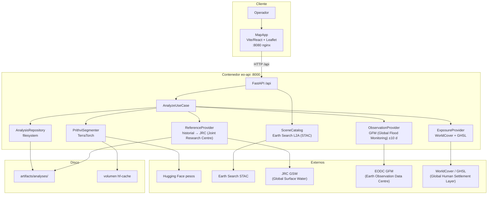

# Diagrama de arquitectura — Tune

Cliente-servidor en dos contenedores. MapApp (nginx :8080) habla con eo-api
(FastAPI :8000). El caso de uso orquesta Prithvi y proveedores externos detrás
de puertos: Joint Research Centre (JRC), Global Flood Monitoring (GFM),
WorldCover / Global Human Settlement Layer (GHSL), Earth Search
(SpatioTemporal Asset Catalog (STAC)). Persistencia en disco (`artifacts/`).

