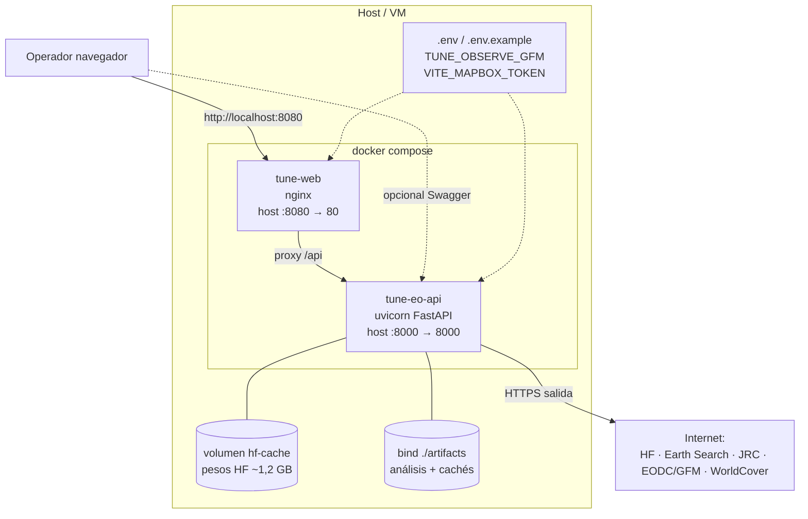

# Diagrama de despliegue — Tune (Docker Compose local)

Entorno previsto: máquina del equipo o Virtual Machine (VM) con Docker. Sin autenticación ni
Hypertext Transfer Protocol Secure (HTTPS) público obligatorio. En VM pública se recomienda `API_BIND=127.0.0.1`.

