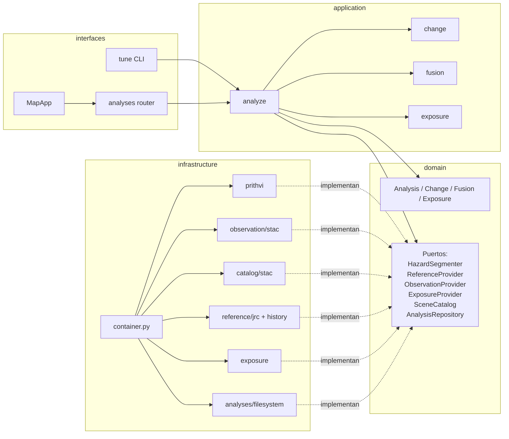

# Diagrama de interacción entre módulos — Tune

Dependencias hacia adentro: `interfaces → application → domain ← infrastructure`.
La web no conoce TerraTorch ni Uniform Resource Locators (URLs) de tiles; solo el contrato `/api` (Application Programming Interface).

