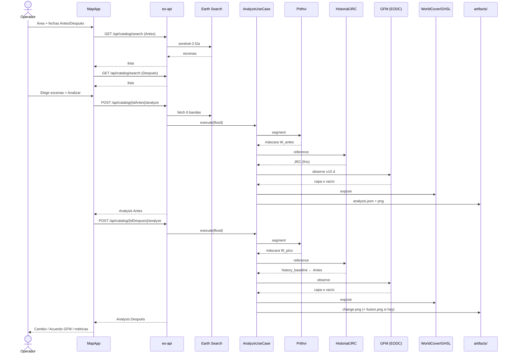

# Diagrama de secuencia — análisis Antes/Después (flujo MapApp)

Caso de uso representativo: el operador fija el Area of Interest (AOI) y dos fechas, elige escenas
Sentinel-2 y analiza. La segunda corrida usa la máscara previa como
`history_baseline` cuando aplica. Global Flood Monitoring (GFM) se consulta tras la segmentación; si no
hay ítem, el análisis sigue sin fusión.

