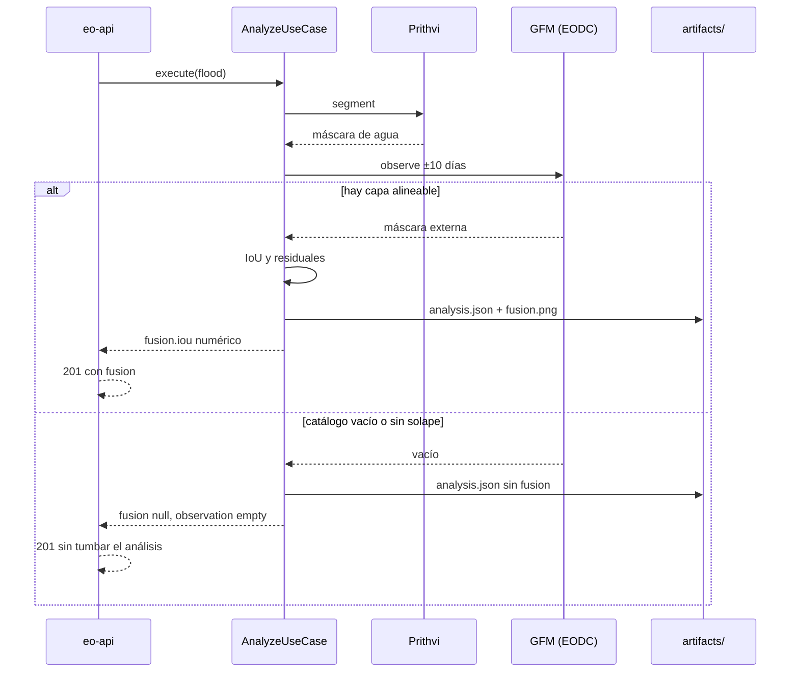

# Diagrama de secuencia — fusión GFM (capa o vacío)

Caso de uso: después de segmentar, Tune consulta Copernicus Global Flood
Monitoring (GFM) en una ventana de ±10 días. Si hay capa, calcula Intersection
over Union (IoU) y guarda `fusion.png`. Si el catálogo no devuelve ítem, el
análisis se guarda igual con `fusion = null` y HTTP 201.

